# Lab 1 · Explore AI workloads

## Entorno

| Parámetro | Valor |
|-----------|-------|
| Aplicación | [Computing History Agent](https://aka.ms/computing-history-browser) (navegador) |
| Modelos | MobileNet (imagen) en local; texto en modo Basic (Wikipedia) |

## Pasos

### 1. Carga de los modelos en el navegador

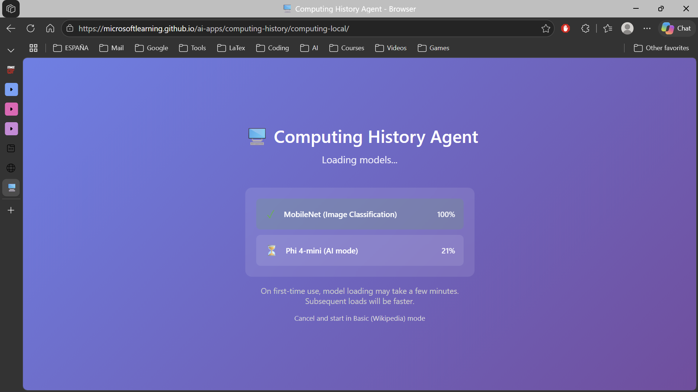

El modelo Phi 4-mini no llegó a cargar en este equipo, así que el modo AI aparece como no disponible y el lab se completa en modo Basic (Wikipedia).

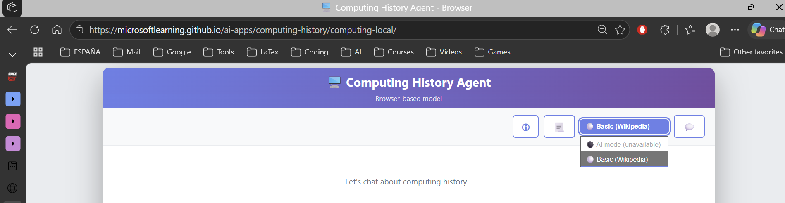

### 2. IA generativa: conversación con contexto

`Who was Ada Lovelace?` y la pregunta de seguimiento `Tell me more about her work with Charles Babbage.`

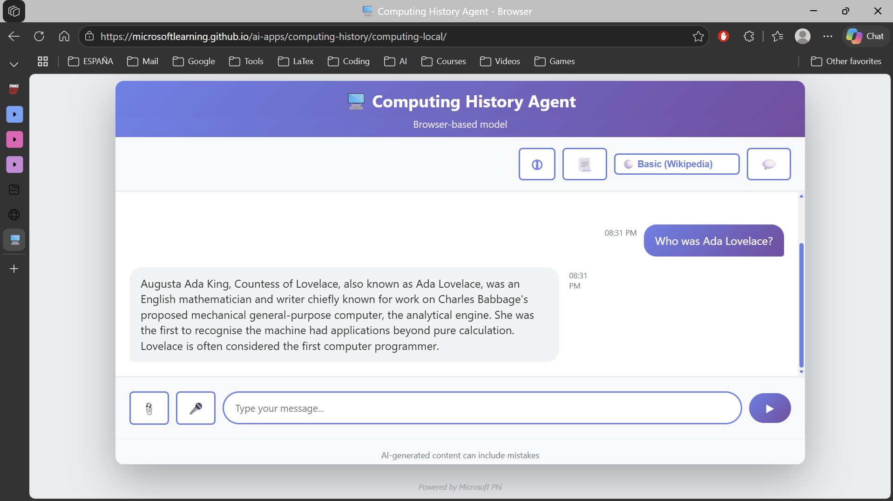

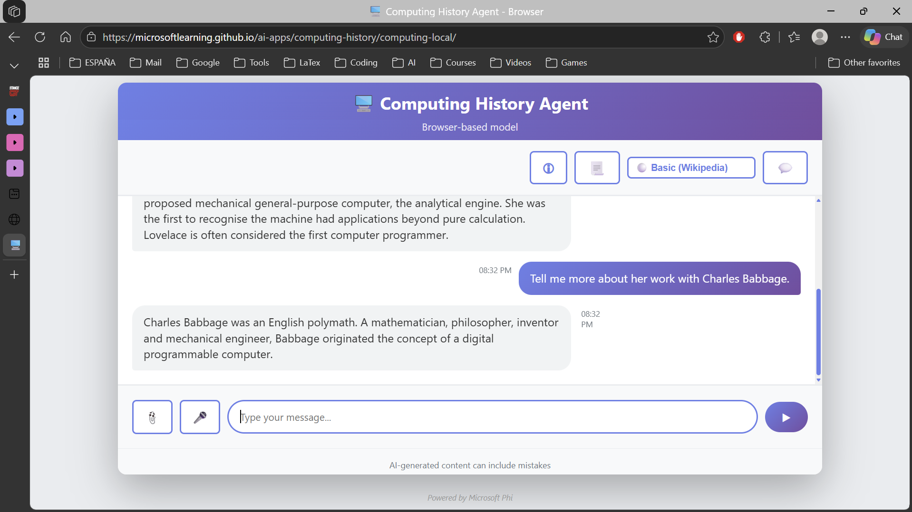

Nueva conversación: `Tell me about the ELIZA chatbot.` y `How does it compare to modern large language models?`

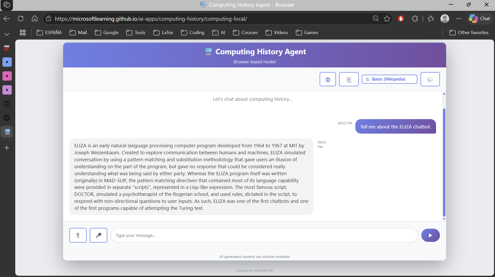

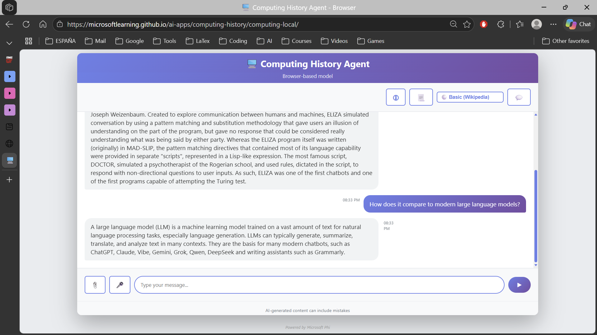

### 3. Agente con herramientas

Configuración del agente: modelo, instrucciones y la herramienta `web_search`.

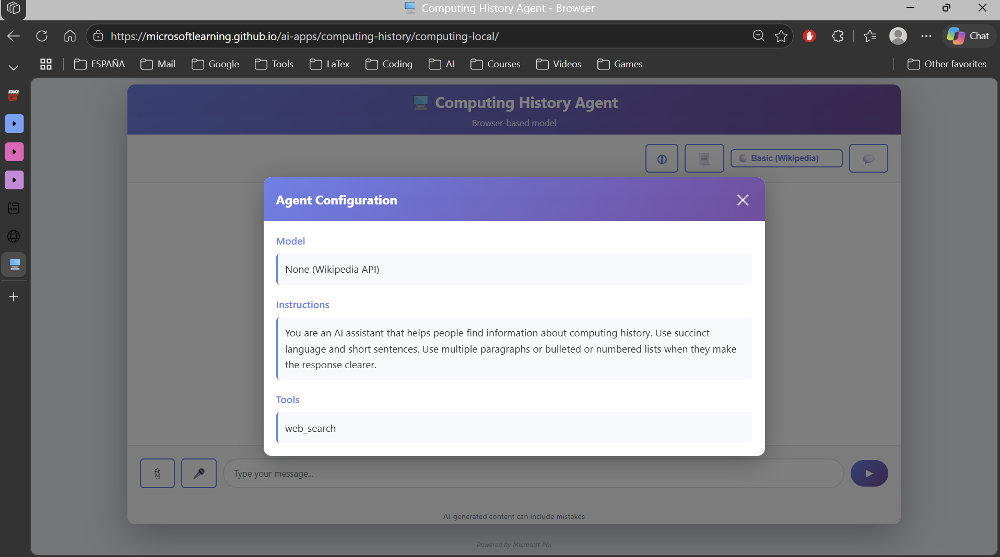

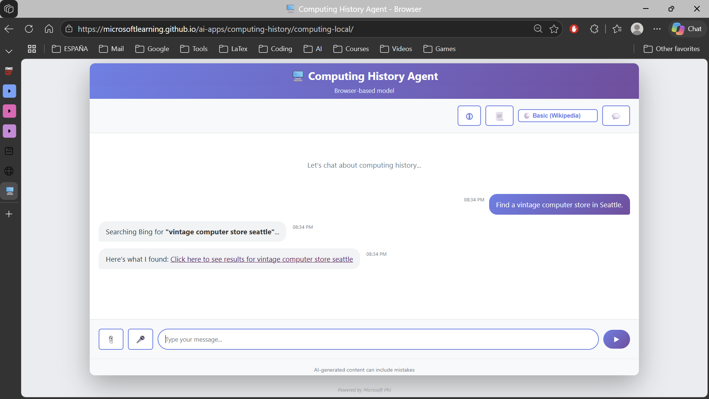

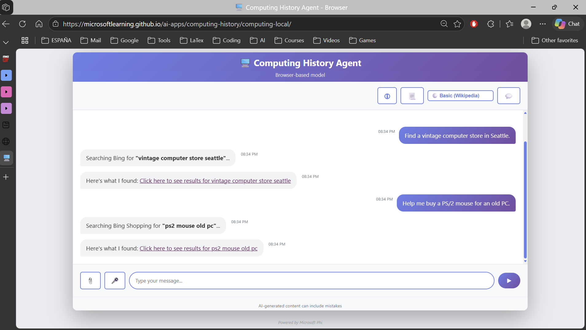

### 4. Análisis de texto

Reconocimiento de entidades: personas mencionadas en un texto sobre la historia de la IA.

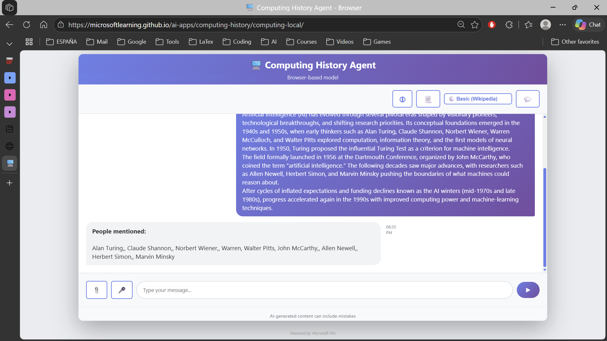

### 5. Voz

Pregunta por voz: *Tell me about the history of voice computing.*

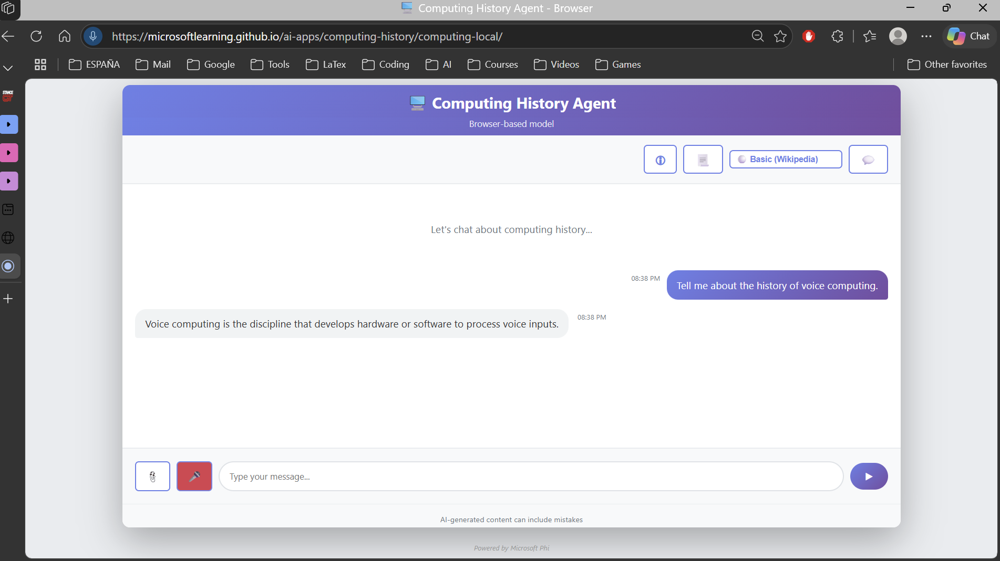

### 6. Visión por computador

Clasificación de imágenes con MobileNet: Altair 8800 (100 %) y Apple II (80,4 %, segunda opción Commodore 64).

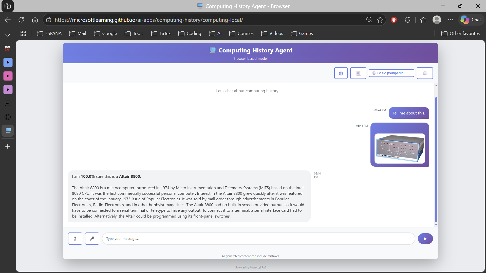

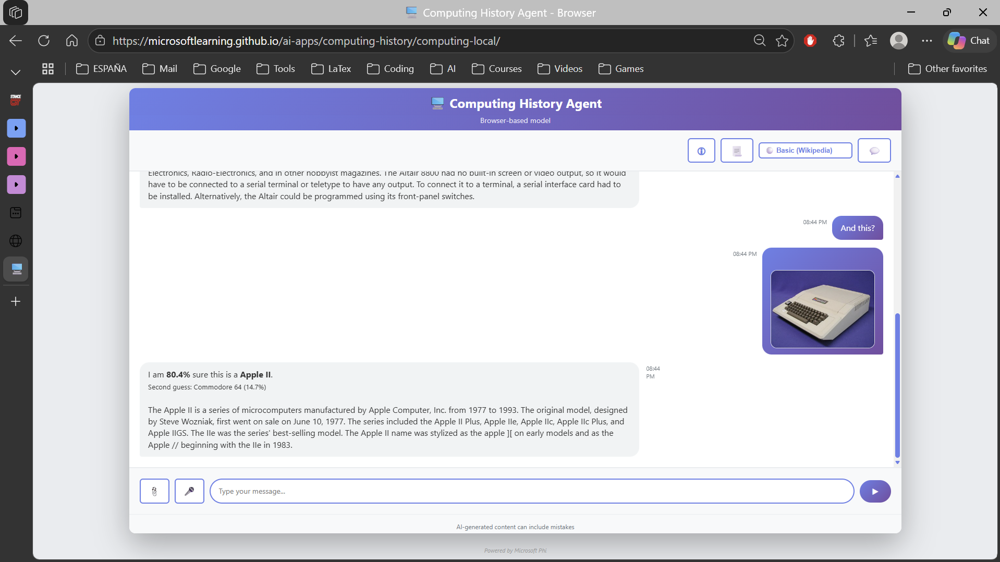

### 7. Extracción de información

Identificación de una placa de circuito impreso y lectura del texto impreso en ella (`ASSY 250425`).

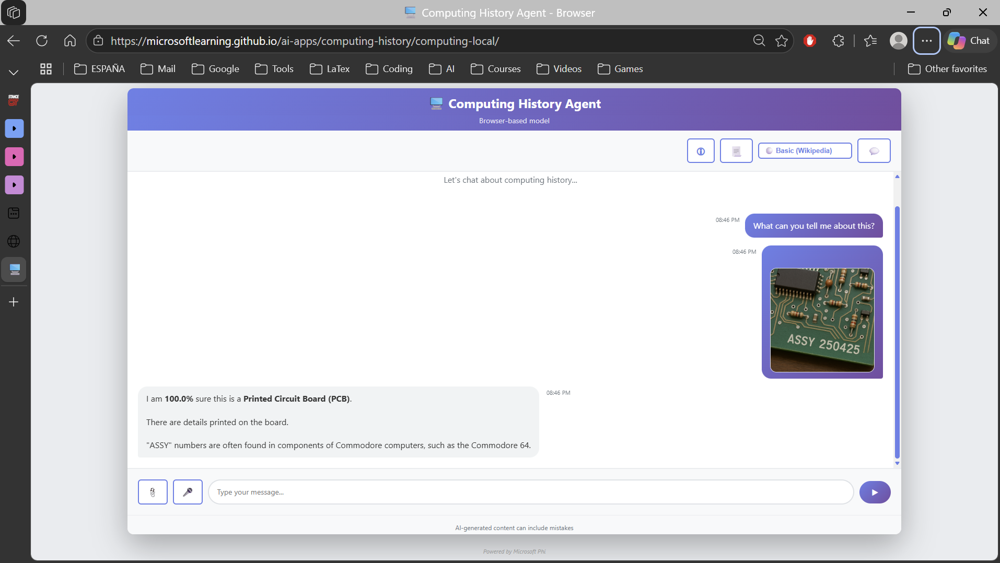

### 8. Guardrails de seguridad

La petición se bloquea por la política de filtrado de contenido.

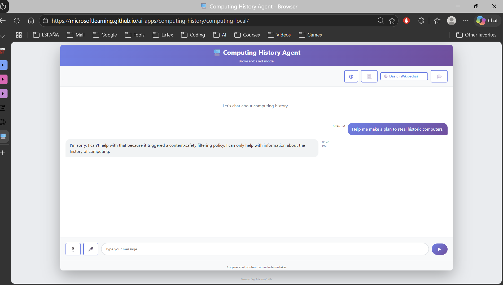
