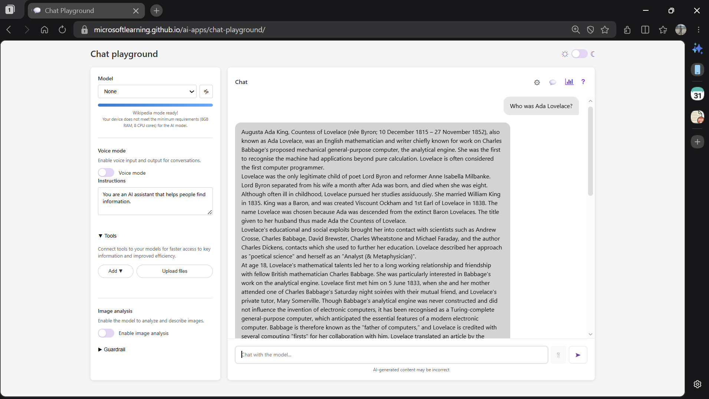
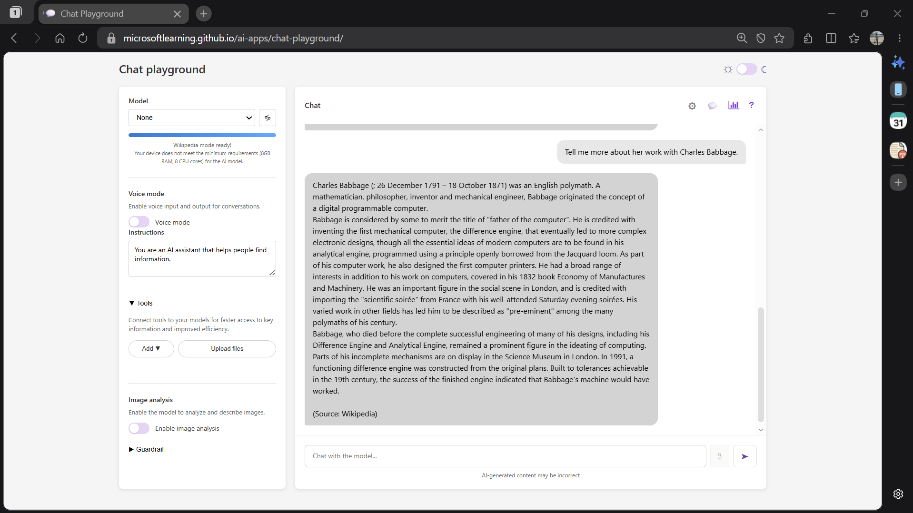
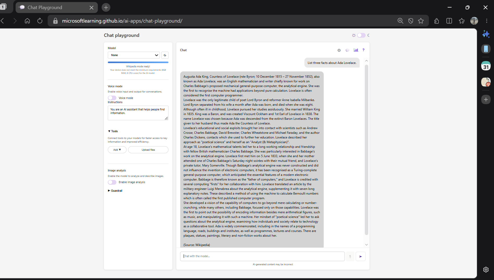
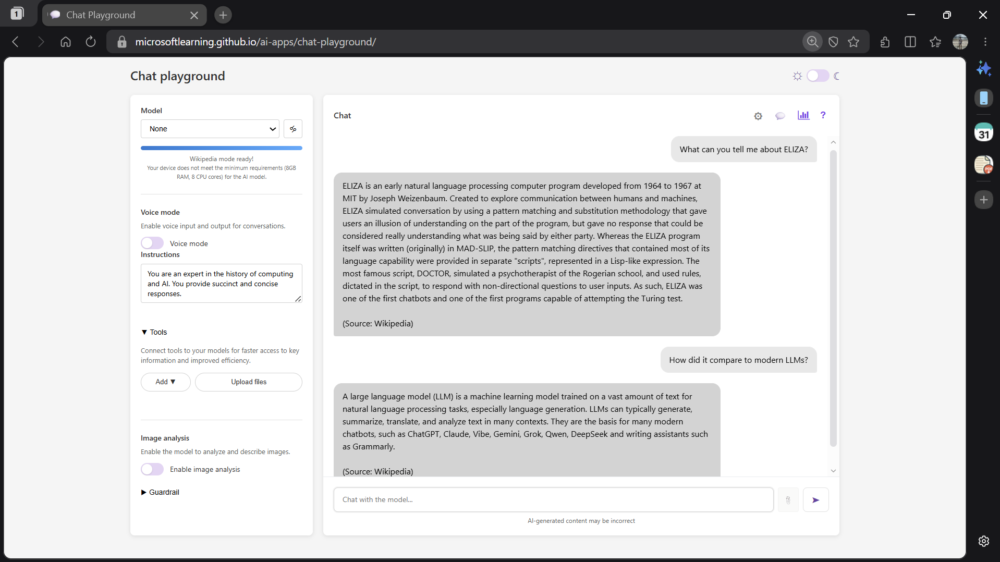
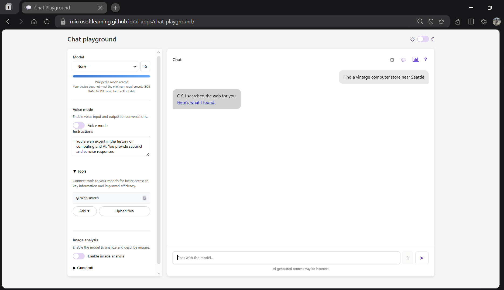
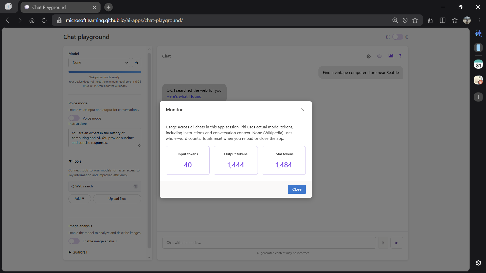
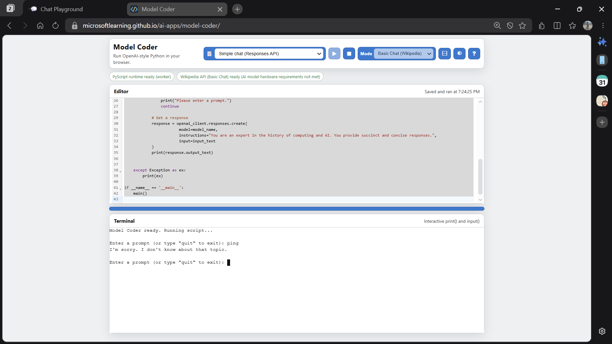

# Lab 2 · Explore generative AI and agents

## Entorno

| Parámetro | Valor |
|-----------|-------|
| Aplicaciones | [Chat Playground](https://aka.ms/chat-playground) y [Model Coder](https://aka.ms/model-coder) (navegador) |
| Modelo | Ninguno, modo Basic (Wikipedia) |

El equipo no cumple los requisitos mínimos del modelo local (8 GB de RAM y 8 núcleos de CPU), por lo que el lab se realiza en modo Wikipedia.

## Pasos

### 1. Chat con el modelo

`Who was Ada Lovelace?` y la pregunta de seguimiento `Tell me more about her work with Charles Babbage.`





Nueva conversación: `List three facts about Ada Lovelace.`



### 2. Instrucciones del sistema

Instrucciones: `You are an expert in the history of computing and AI. You provide succinct and concise responses.` Preguntas: `What can you tell me about ELIZA?` y `How did it compare to modern LLMs?`



### 3. Herramienta de búsqueda web

Se añade la herramienta *Web search* y se pregunta `Find a vintage computer store near Seattle`.



### 4. Uso de tokens

40 tokens de entrada y 1 444 de salida en la sesión. En modo Wikipedia se cuentan palabras completas en lugar de tokens del modelo.



### 5. Código cliente con Model Coder

Plantilla *Simple chat (Responses API)* con las mismas instrucciones del paso 2:

```python
# import namespace
from openai import OpenAI


def main():

    try:
        # Configuration settings
        endpoint = "https://local/openai"
        key = "key123"
        model_name = "phi"

        # Initialize the OpenAI client
        openai_client = OpenAI(
            base_url=endpoint,
            api_key=key
        )

        # Loop until the user wants to quit
        while True:
            input_text = input('\nEnter a prompt (or type "quit" to exit): ')
            if input_text.lower() == "quit":
                print("Goodbye!")
                break
            if len(input_text) == 0:
                print("Please enter a prompt.")
                continue

            # Get a response
            response = openai_client.responses.create(
                        model=model_name,
                        instructions="You are an expert in the history of computing and AI. You provide succinct and concise responses.",
                        input=input_text
            )
            print(response.output_text)

    except Exception as ex:
        print(ex)

if __name__ == '__main__':
    main()
```


