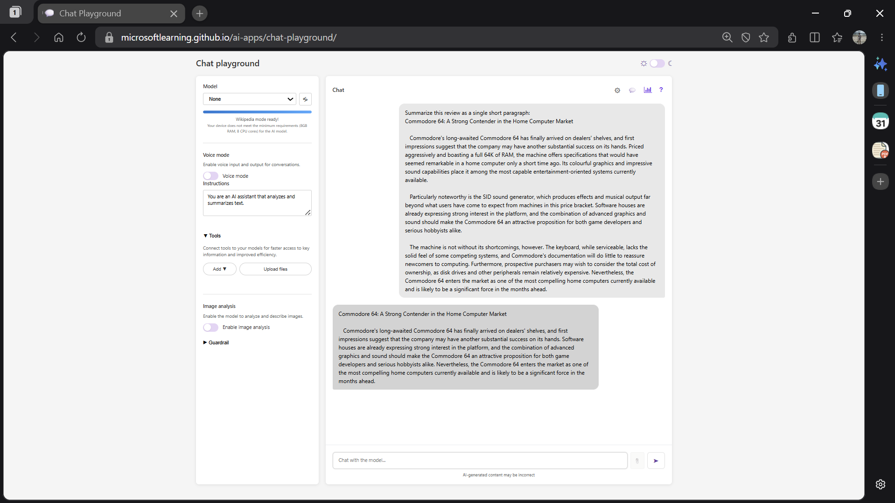
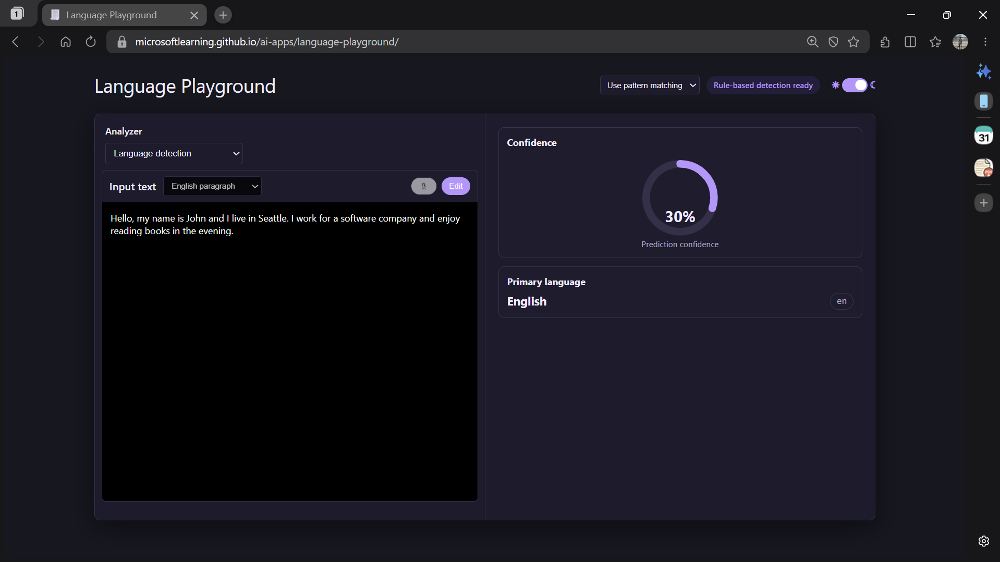
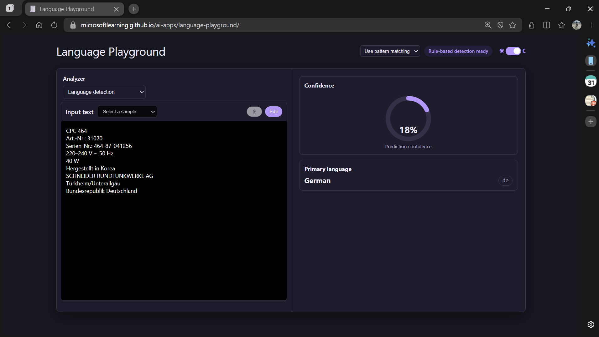
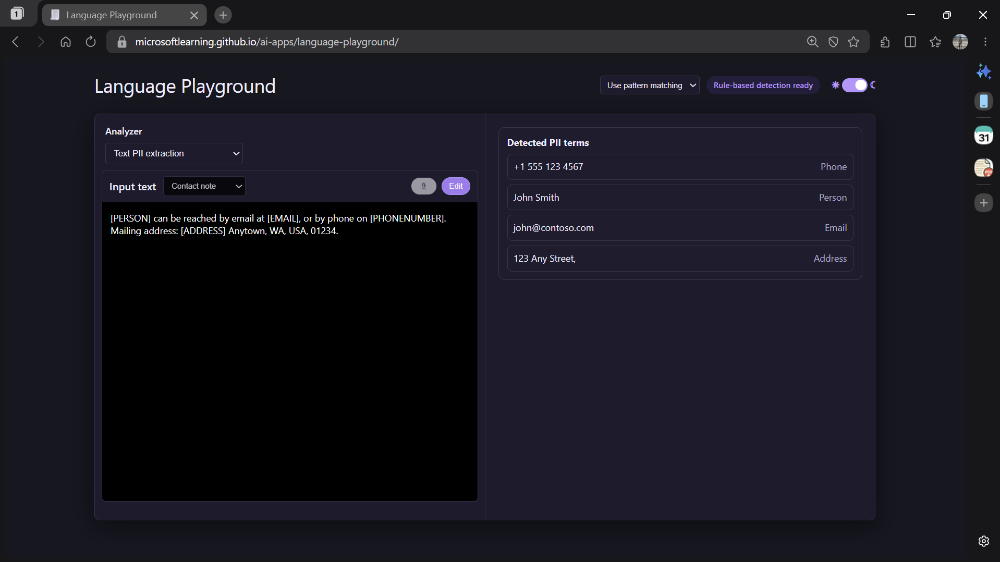
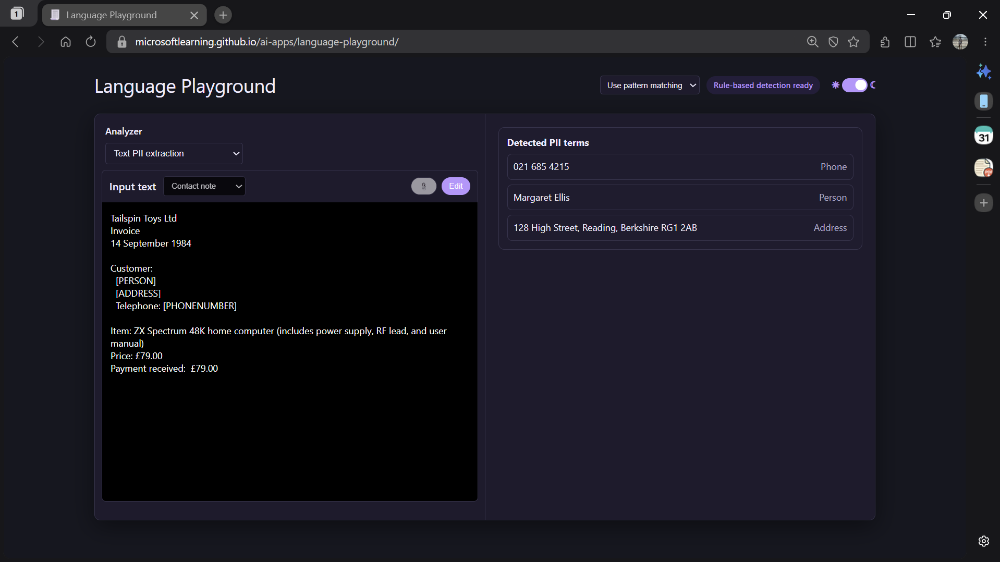

# Lab 3 · Explore text analytics

## Entorno

| Parámetro | Valor |
|-----------|-------|
| Aplicaciones | [Chat Playground](https://aka.ms/chat-playground) y [Language Playground](https://aka.ms/language-app) (navegador) |
| Modo | Chat Playground en modo Wikipedia; Language Playground con detección basada en reglas (*pattern matching*) |

El equipo no cumple los requisitos mínimos del modelo local (8 GB de RAM y 8 núcleos de CPU), por lo que se usan los modos alternativos sin modelo.

## Pasos

### 1. Resumen de texto con Chat Playground

Instrucciones: `You are an AI assistant that analyzes and summarizes text.` Prompt: `Summarize this review as a single short paragraph:` seguido de la review del Commodore 64.

### 2. Detección de idioma

Muestra en inglés:

Etiqueta del Schneider CPC 464, detectada como alemán:

### 3. Extracción de datos personales (PII)

Muestra *Contact note*: teléfono, persona, email y dirección.

Factura de Tailspin Toys: nombre del cliente, dirección y teléfono.

