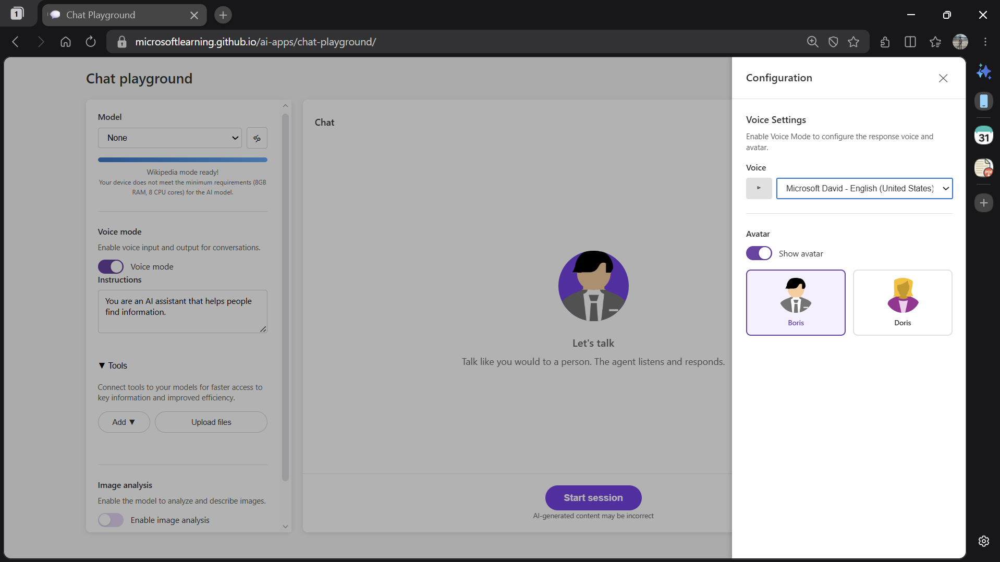
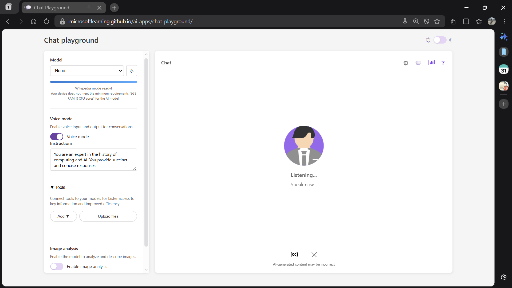
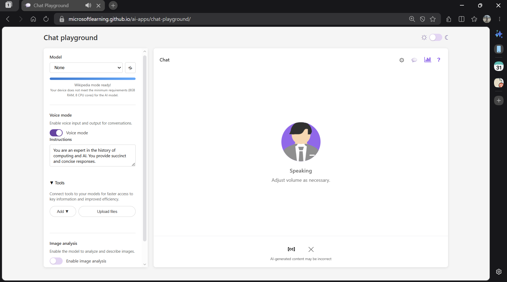
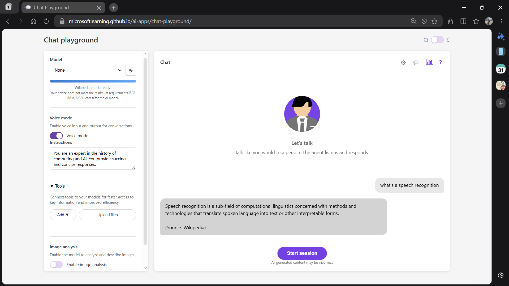

# Lab 4 · Explore AI speech

## Entorno

| Parámetro | Valor |
|-----------|-------|
| Aplicación | [Chat Playground](https://aka.ms/chat-playground) (navegador) |
| Modelo | Ninguno, modo Basic (Wikipedia) |
| Voz | Microsoft David - English (United States), avatar Boris |

El equipo no cumple los requisitos mínimos del modelo local (8 GB de RAM y 8 núcleos de CPU), por lo que las respuestas proceden de Wikipedia. El reconocimiento y la síntesis de voz los realiza el navegador.

## Pasos

### 1. Configuración del modo de voz

### 2. Reconocimiento de voz

Sesión iniciada con las instrucciones `You are an expert in the history of computing and AI. You provide succinct and concise responses.` La aplicación escucha la pregunta *What's speech recognition?*

### 3. Síntesis de voz

La respuesta se convierte a audio y se reproduce.

### 4. Transcripción de la conversación

Al cerrar la sesión se muestra la transcripción.

