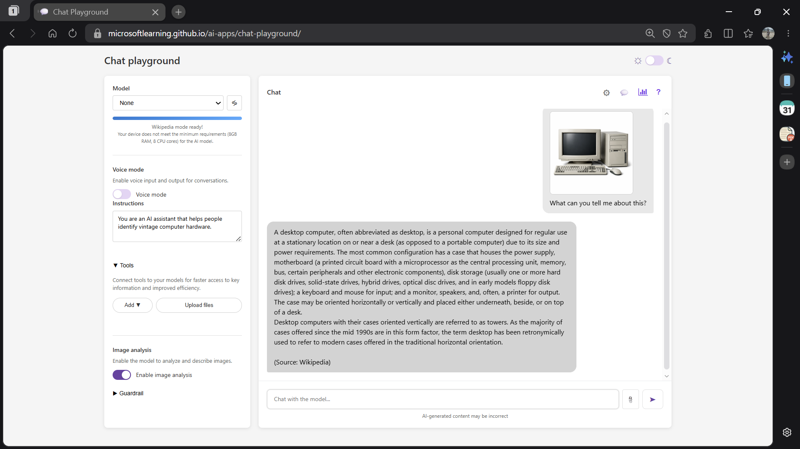
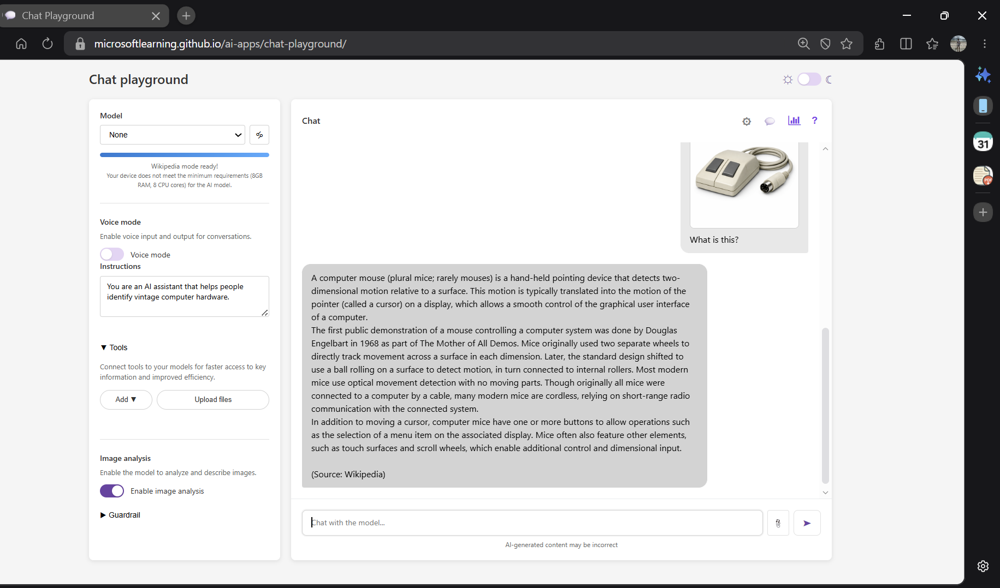
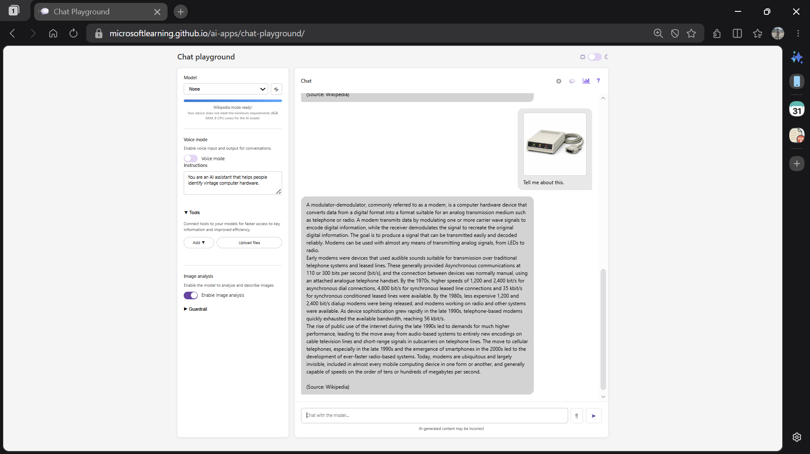

# Lab 5 · Explore computer vision

## Entorno

| Parámetro | Valor |
|-----------|-------|
| Aplicación | [Chat Playground](https://aka.ms/chat-playground) (navegador) |
| Modelo | Ninguno, modo Basic (Wikipedia), con *Image analysis* activado |
| Imágenes | [`files/images`](./files/images/) |

El equipo no cumple los requisitos mínimos del modelo local (8 GB de RAM y 8 núcleos de CPU). El modelo de visión clasifica la imagen y la descripción se obtiene de Wikipedia.

## Pasos

### 1. Análisis de imagen: ordenador de sobremesa

Instrucciones: `You are an AI assistant that helps people identify vintage computer hardware.` Se activa *Image analysis*, se sube una imagen y se pregunta `What can you tell me about this?`

### 2. Análisis de imagen: ratón

`What is this?`

### 3. Análisis de imagen: módem

`Tell me about this.`

