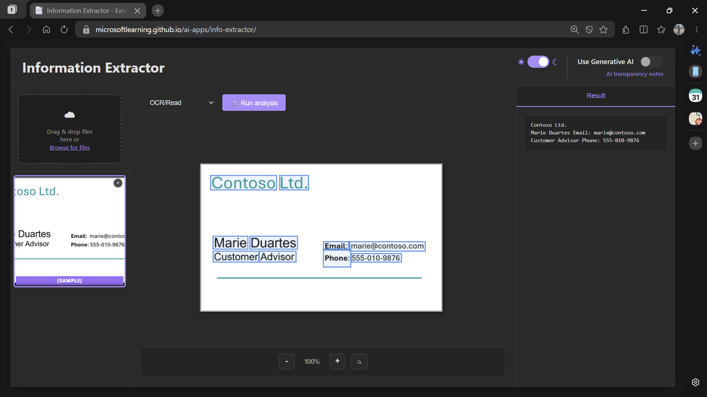
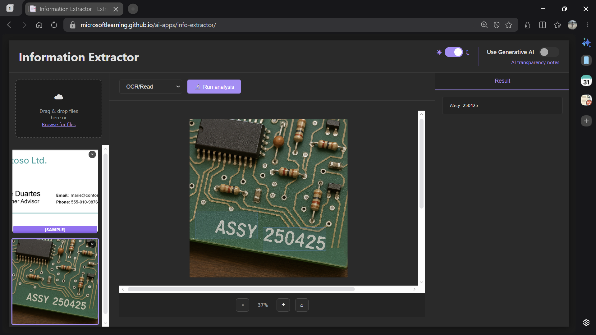
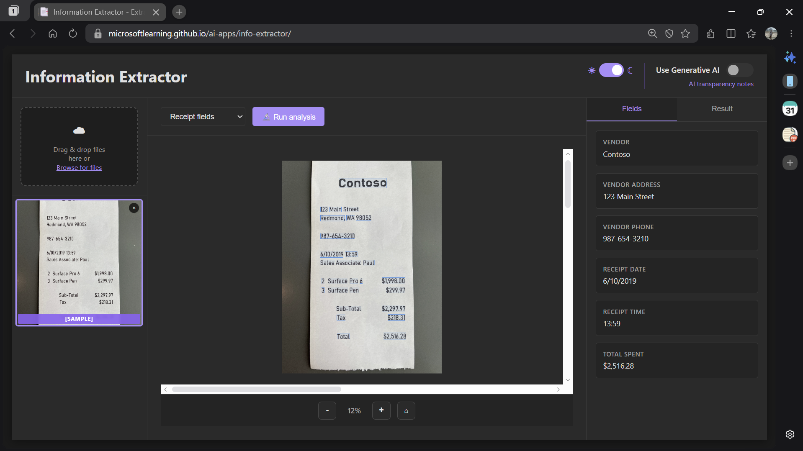
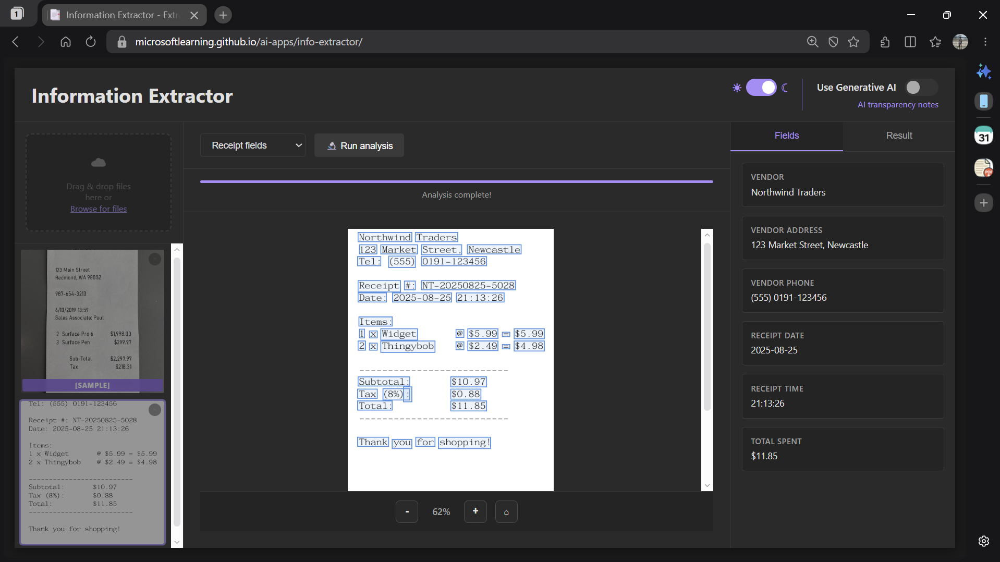

# Lab 6 · Explore information extraction

## Entorno

| Parámetro | Valor |
|-----------|-------|
| Aplicación | [Information Extractor](https://aka.ms/info-extractor) (navegador) |
| Modo | OCR y extracción de campos sin IA generativa (*Use Generative AI* desactivado) |
| Imágenes | [`files/pcbs`](./files/pcbs/) y [`files/receipts`](./files/receipts/) |

## Pasos

### 1. OCR de una tarjeta de visita

Análisis *OCR/Read* de la tarjeta de ejemplo: empresa, nombre, cargo, email y teléfono.

### 2. OCR de una placa de circuito impreso

Lectura del texto impreso en `pcb-1.png` (`ASSY 250425`).

### 3. Extracción de campos de un recibo de ejemplo

Modo *Receipt fields*: comercio, dirección, teléfono, fecha, hora y total.

### 4. Extracción de campos de un recibo propio

Recibo de Northwind Traders subido desde `files/receipts`.

