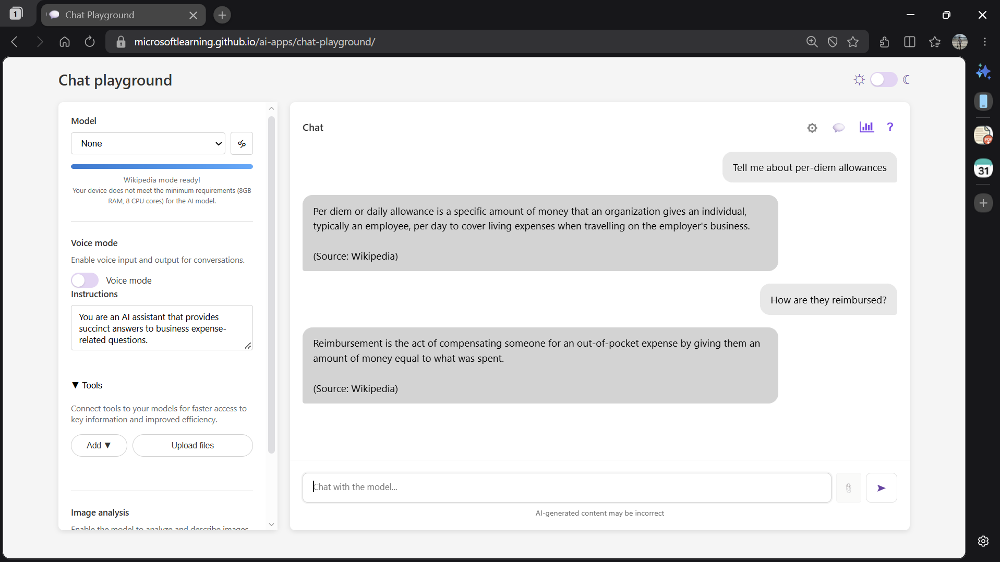
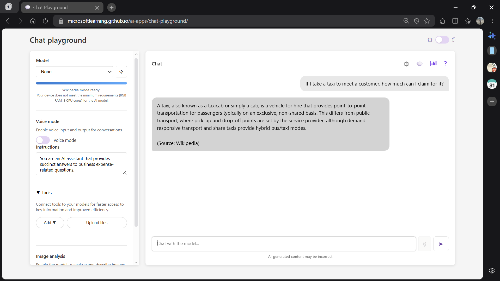
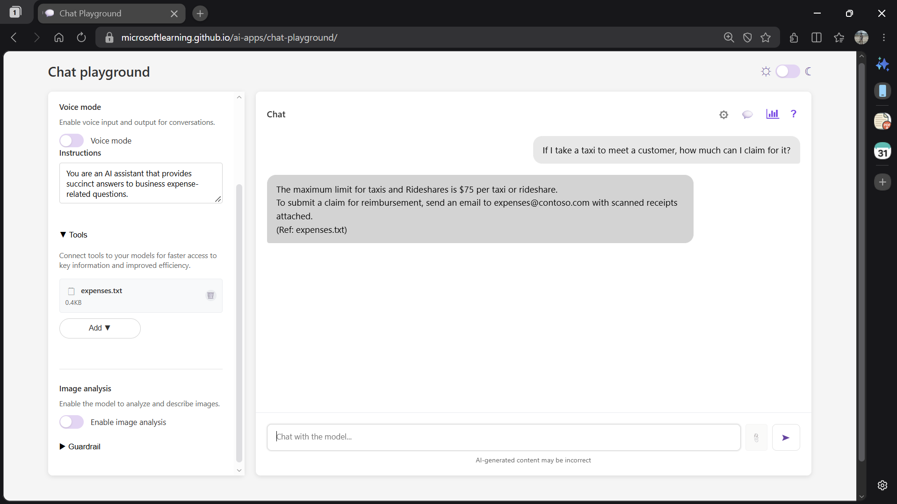
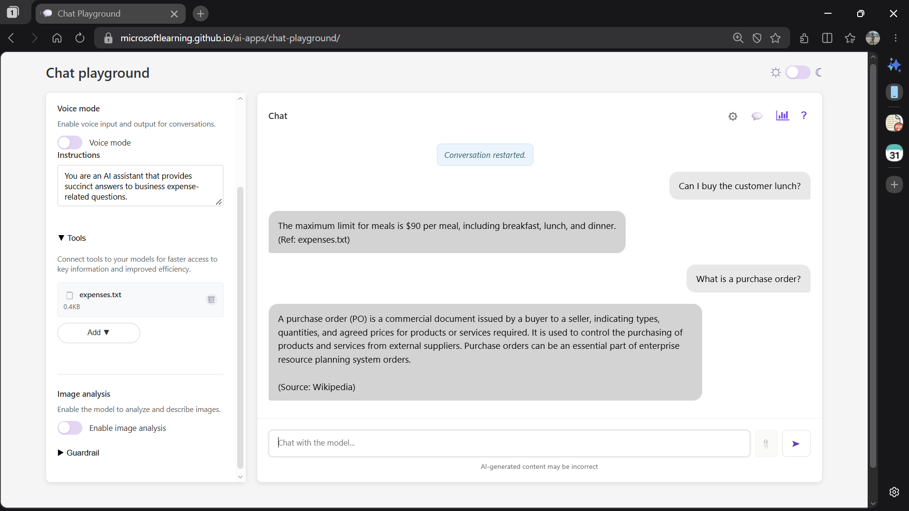

# Lab 7 · Explore retrieval augmented generation (RAG)

## Entorno

| Parámetro | Valor |
|-----------|-------|
| Aplicación | [Chat Playground](https://aka.ms/chat-playground) (navegador) |
| Modelo | Ninguno, modo Basic (Wikipedia) |
| Fuente de conocimiento | [`files/expenses.txt`](./files/expenses.txt) |

El equipo no cumple los requisitos mínimos del modelo local (8 GB de RAM y 8 núcleos de CPU), por lo que sin fuente de conocimiento las respuestas proceden de Wikipedia.

## Pasos

### 1. Preguntas generales sin RAG

Instrucciones: `You are an AI assistant that provides succinct answers to business expense-related questions.` Preguntas: `Tell me about per-diem allowances.` y `How are they reimbursed?`

### 2. Pregunta específica sin RAG

`If I take a taxi to meet a customer, how much can I claim for it?` La respuesta es genérica y no tiene que ver con la política de gastos de la empresa.

### 3. La misma pregunta con RAG

Se sube `expenses.txt` como fuente de conocimiento. La respuesta ya usa la política de la empresa (máximo de 75 $ por taxi) y cita el fichero.

### 4. Más preguntas con RAG

`Can I buy the customer lunch?` se responde con el fichero (máximo de 90 $ por comida). `What is a purchase order?` no aparece en el fichero, así que la respuesta no lo cita.

