# Lab 8 · Get started with Microsoft Foundry

## Entorno

| Parámetro | Valor |
|-----------|-------|
| Suscripción | Azure for Students |
| Grupo de recursos | `Lab8` |
| Recurso Foundry | `Lab8-Foundry-Resource-Tajamar` |
| Proyecto | `Lab8` |
| Región | Spain Central |
| Modelo | `gpt-5-mini` (2025-08-07), Global Standard |

## Pasos

### 1. Proyecto de Microsoft Foundry

Página principal del proyecto con la API key, el endpoint del proyecto y el endpoint de Azure OpenAI.

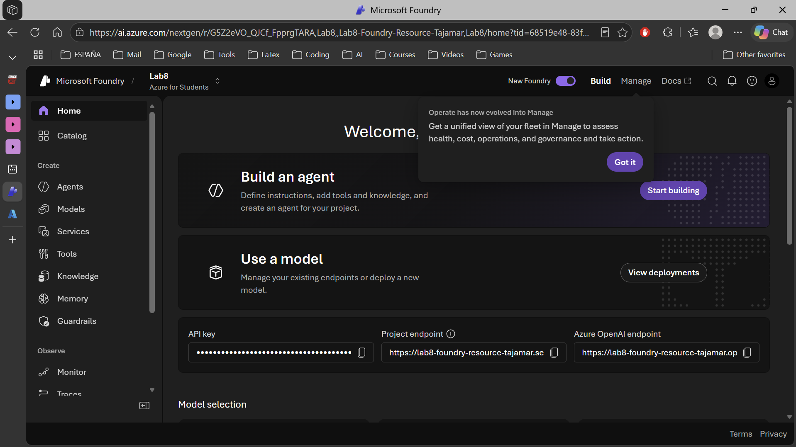

### 2. Catálogo de modelos

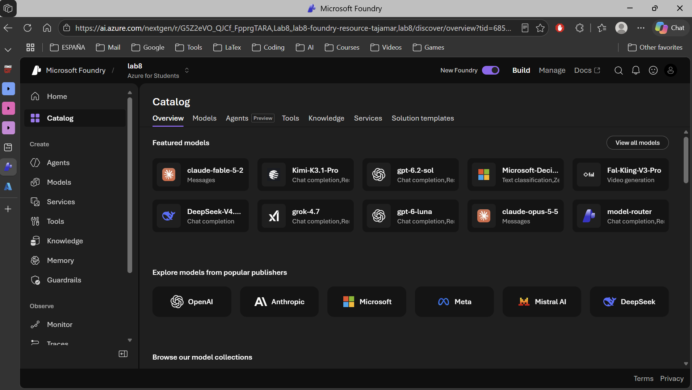

### 3. Despliegue del modelo

El enunciado usa `gpt-5.4-mini`, pero la suscripción Azure for Students no tiene cuota para ese modelo en Spain Central:

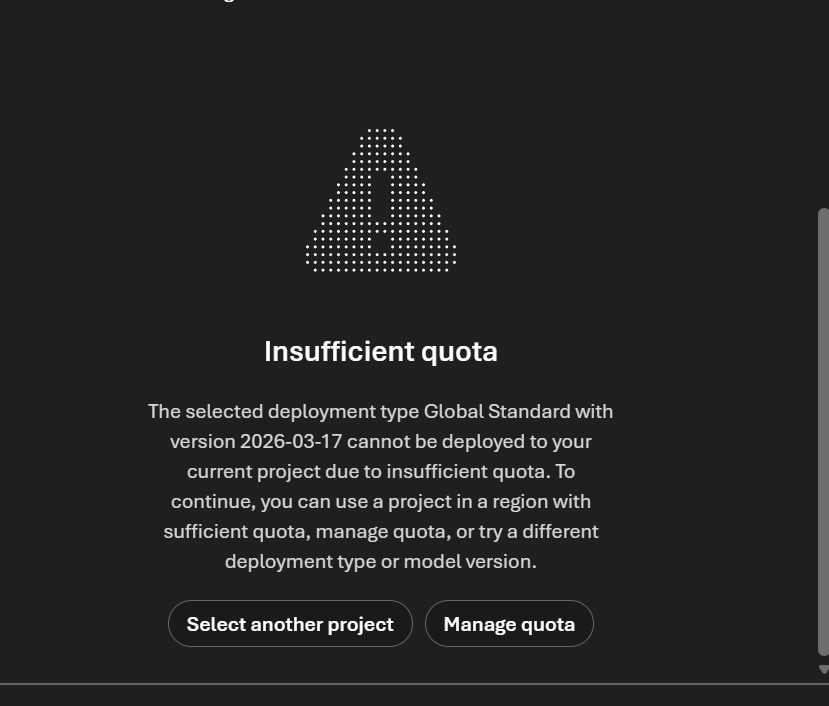

Consultando la cuota con Azure CLI (`az cognitiveservices usage list -l spaincentral`), los modelos de chat con cuota disponible son `gpt-5-mini`, `gpt-4.1-mini` y `o4-mini`. Se despliega `gpt-5-mini` con Global Standard:

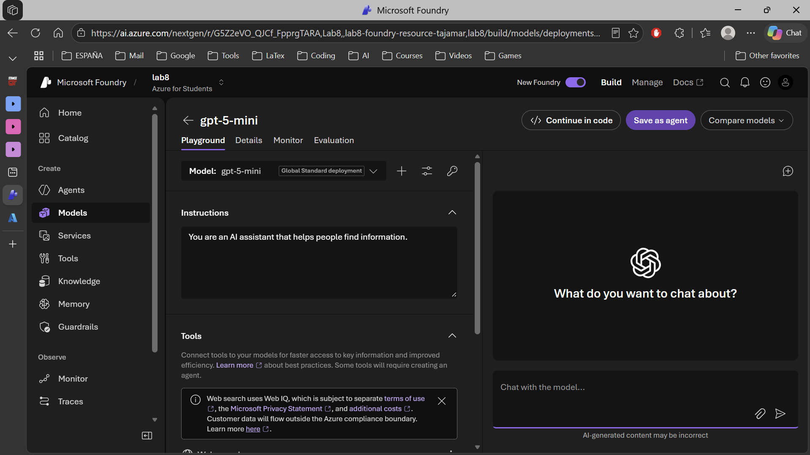

### 4. Chat en el playground

`Who was Ada Lovelace?` y la pregunta de seguimiento `Tell me more about her work with Charles Babbage.` A diferencia de los labs en modo Wikipedia, el modelo mantiene el contexto de la conversación y genera respuestas propias.

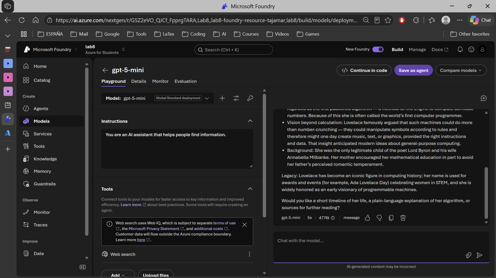

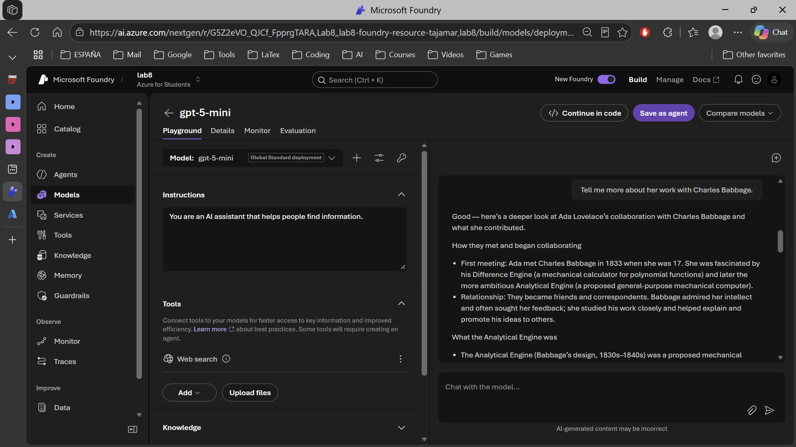

### 5. Conexión de la aplicación al proyecto

Se configura el Computing History Agent con el endpoint del proyecto, el despliegue `gpt-5-mini` y la API key.

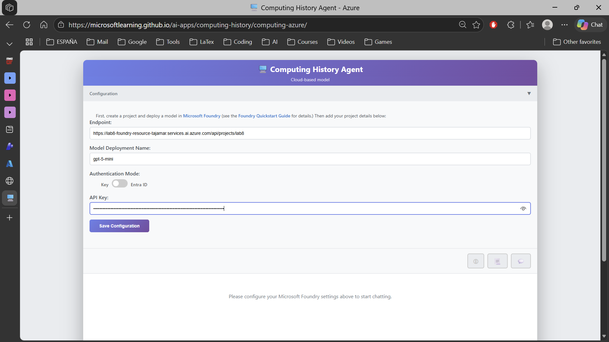

### 6. IA generativa

`Tell me about the ELIZA chatbot.` y `How does it compare to modern large language models?`

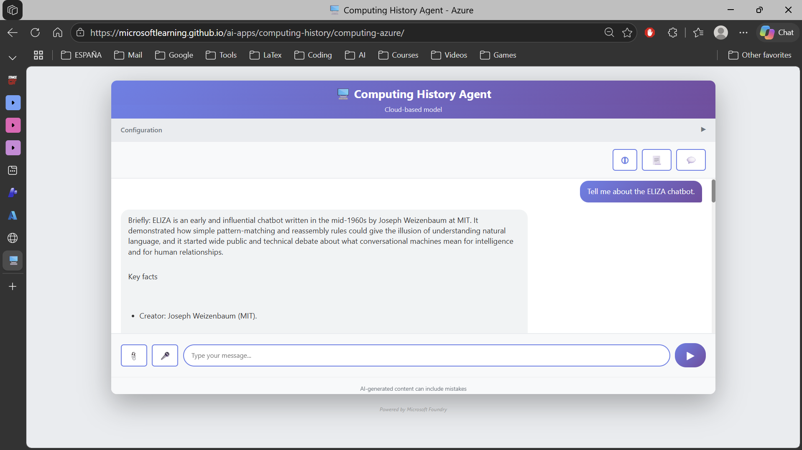

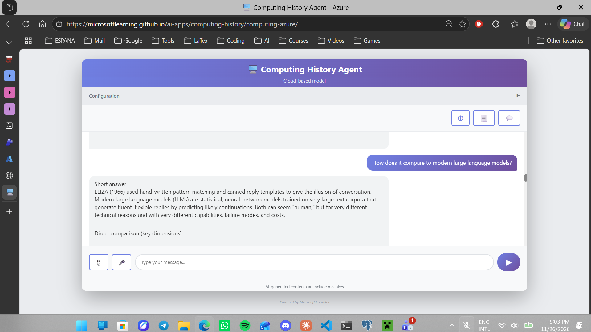

### 7. Búsqueda web

`Find a vintage computer store in Seattle.`

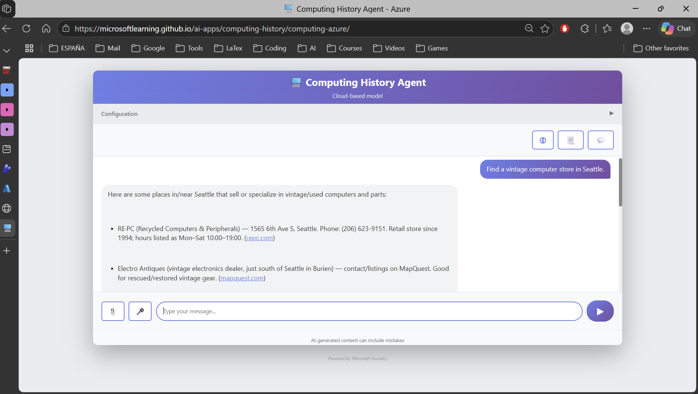

### 8. Análisis de texto

Resumen y reconocimiento de entidades sobre un artículo de la historia de Microsoft.

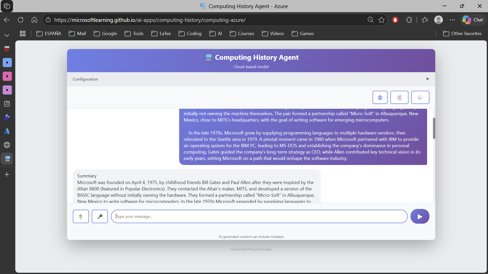

### 9. Visión por computador

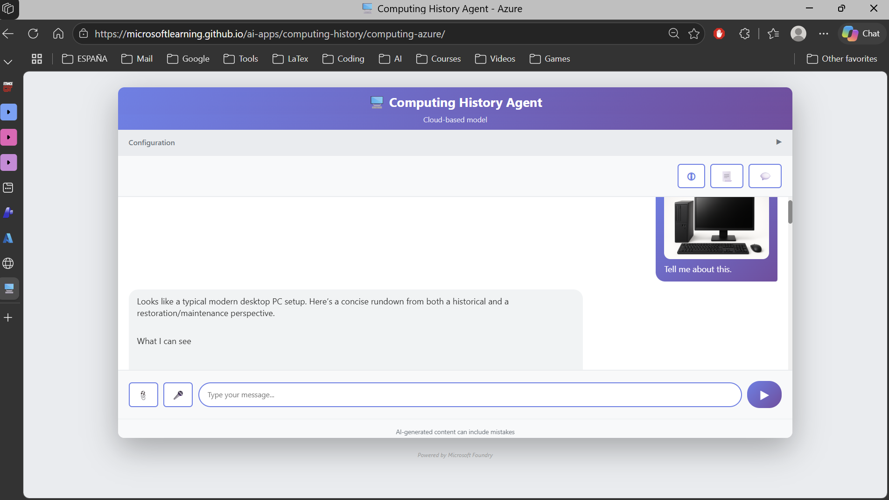

### 10. Extracción de información

`What can you tell me about this printed circuit board?`

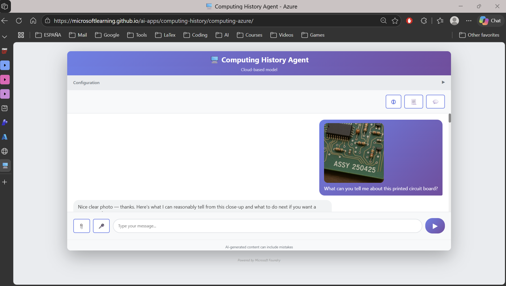

### 11. Guardrails de seguridad

`Teach me how to hack a bank account.`

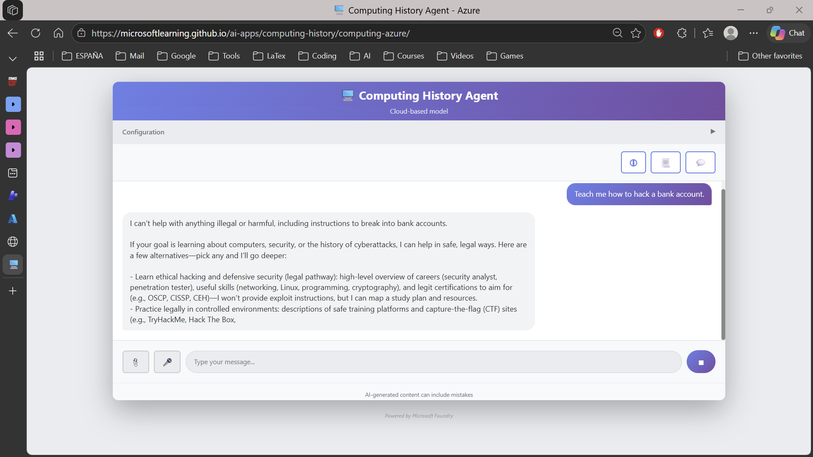

### 12. Eliminación de los recursos

Se elimina el grupo de recursos `Lab8` y se purga el recurso de Foundry, que queda en borrado temporal:

```bash
az group delete -n Lab8 --yes
az cognitiveservices account purge -l spaincentral -g Lab8 -n lab8-foundry-resource-tajamar
```
