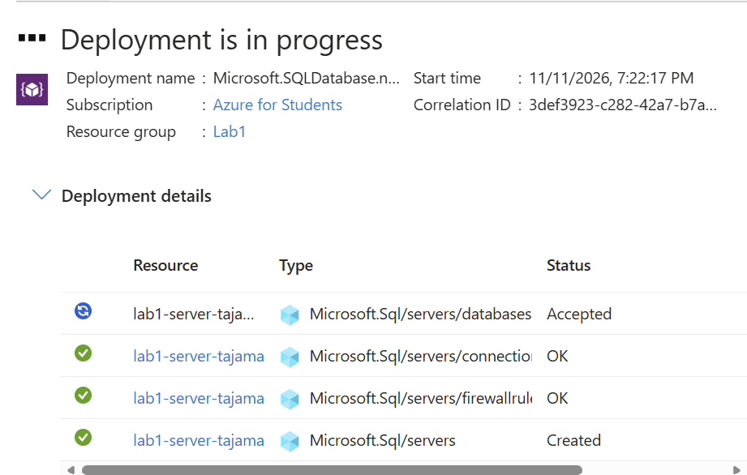

# Lab 1 · Crear una Azure SQL Database

## Objetivo
Desplegar una base de datos Azure SQL Database (PaaS) junto con su servidor lógico en Azure.

## Entorno
| Parámetro | Valor |
|-----------|-------|
| Suscripción | Azure for Students |
| Grupo de recursos | `Lab1` |
| Servidor lógico | `lab1-server-tajama...` |

## Pasos

### 1. Despliegue en curso
Tras revisar la configuración y pulsar **Create**, Azure lanza el despliegue de la plantilla `Microsoft.SQLDatabase`.

| Recurso | Tipo | Estado |
|---------|------|--------|
| Servidor lógico | `Microsoft.Sql/servers` | Created |
| Reglas de firewall | `Microsoft.Sql/servers/firewallRules` | OK |
| Política de conexión | `Microsoft.Sql/servers/connectionPolicies` | OK |
| Base de datos | `Microsoft.Sql/servers/databases` | Accepted ⏳ |

> 💡 **Nota DP-900:** el *servidor lógico* no es una máquina virtual; es un punto de administración común (login, firewall, políticas) para una o varias bases de datos. La base de datos se despliega la última porque depende del servidor.
