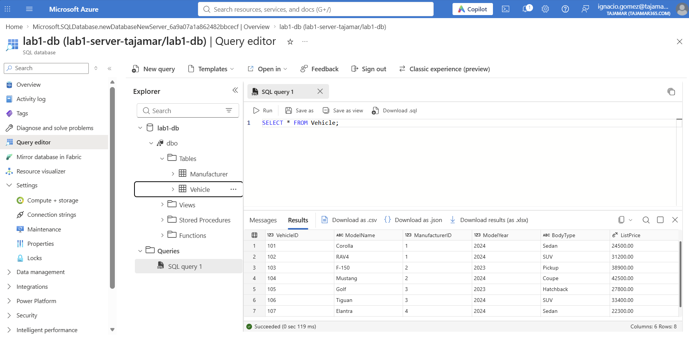
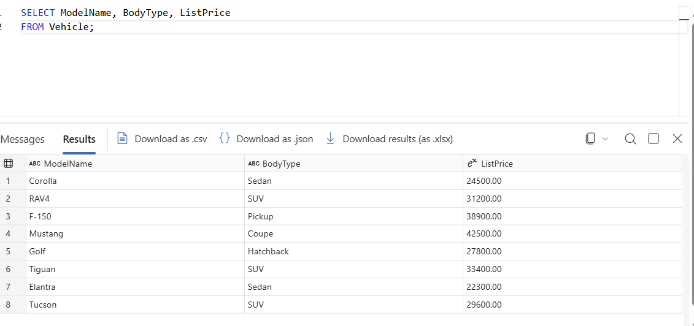
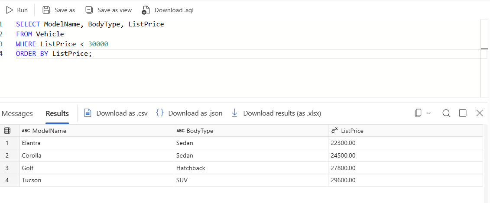
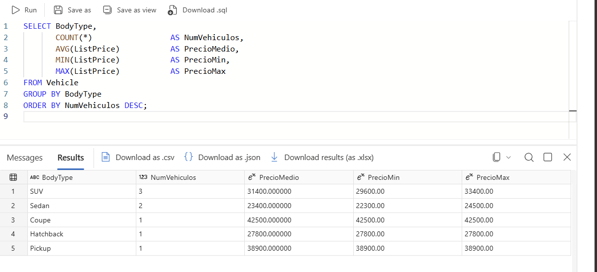
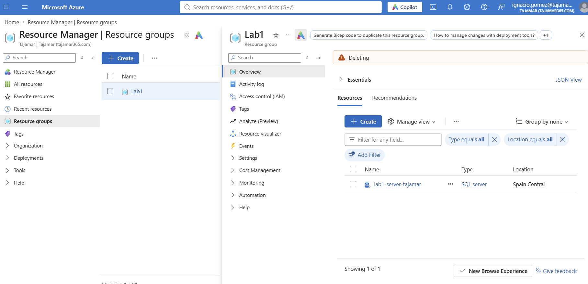

# Lab 1 · Azure SQL Database

## Entorno

| Parámetro | Valor |
|-----------|-------|
| Suscripción | Azure for Students |
| Grupo de recursos | `Lab1` |
| Servidor lógico | `lab1-server-tajamar` |
| Base de datos | `lab1-db` |
| Región | Spain Central |

## Pasos

### 1. Despliegue

Creación del servidor lógico y la base de datos desde el portal.


### 2. Consulta de la tabla Vehicle

Desde el Query editor de `lab1-db`:

```sql
SELECT * FROM Vehicle;
```



### 3. Selección de columnas

```sql
SELECT ModelName, BodyType, ListPrice
FROM Vehicle;
```



### 4. Filtrado y ordenación

```sql
SELECT ModelName, BodyType, ListPrice
FROM Vehicle
WHERE ListPrice < 30000
ORDER BY ListPrice;
```



### 5. Agregados por tipo de carrocería

```sql
SELECT BodyType,
       COUNT(*)       AS NumVehiculos,
       AVG(ListPrice) AS PrecioMedio,
       MIN(ListPrice) AS PrecioMin,
       MAX(ListPrice) AS PrecioMax
FROM Vehicle
GROUP BY BodyType
ORDER BY NumVehiculos DESC;
```



### 6. Eliminación del grupo de recursos

Borrado del grupo `Lab1` para no dejar recursos activos.


