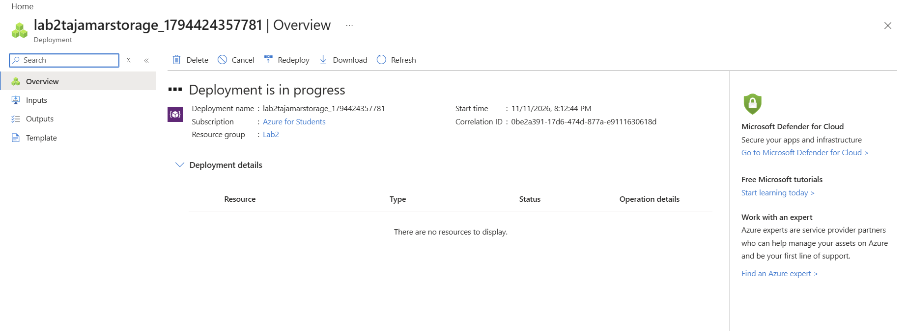
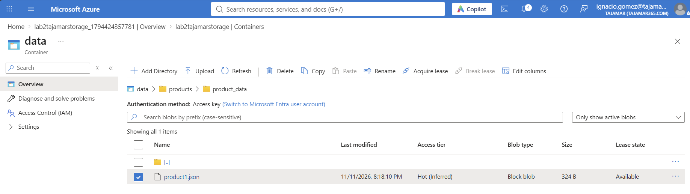
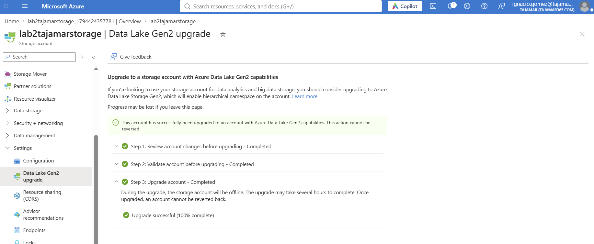
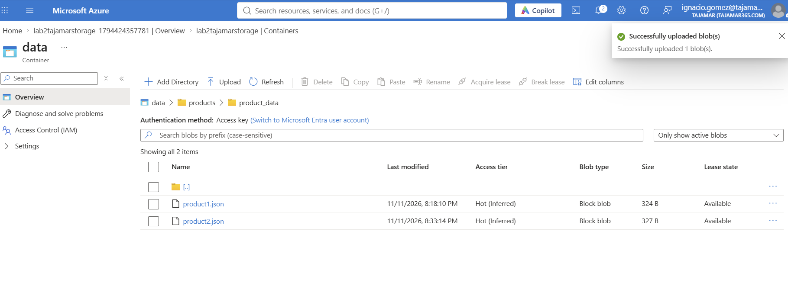
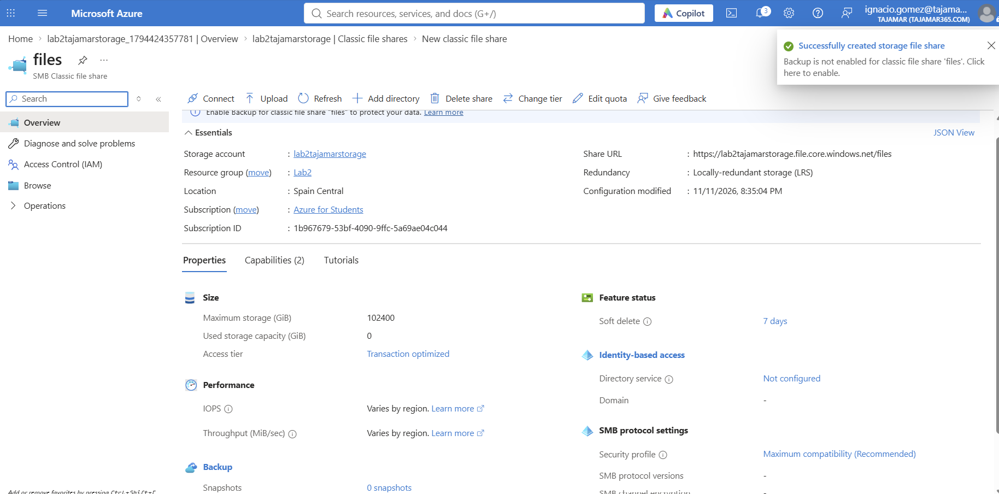
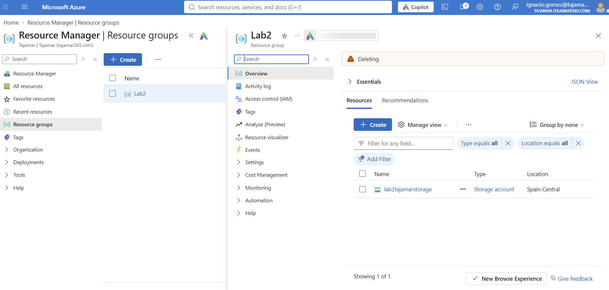

# Lab 2 · Azure Storage

## Entorno

| Parámetro | Valor |
|-----------|-------|
| Suscripción | Azure for Students |
| Grupo de recursos | `Lab2` |
| Storage account | `lab2tajamarstorage` |
| Región | Spain Central |
| Rendimiento | Standard |
| Redundancia | LRS |

## Pasos

### 1. Despliegue del storage account

### 2. Subida de product1.json al contenedor data

### 3. Upgrade a Data Lake Storage Gen2

Antes de validar fue necesario desactivar el soft delete de contenedores (`containerDeleteRetentionPolicy`) en Data protection.

### 4. Subida de product2.json

### 5. Creación del file share

### 6. Eliminación del grupo de recursos

