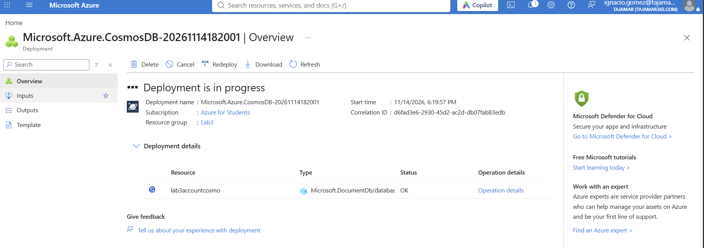
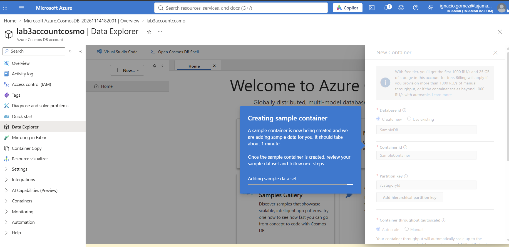
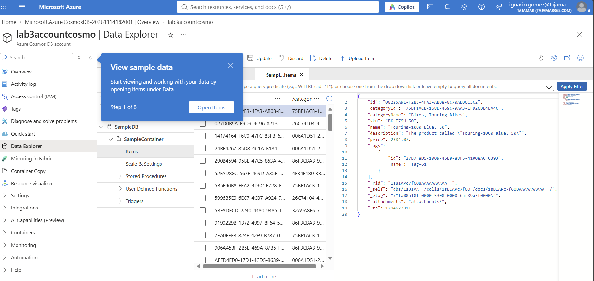
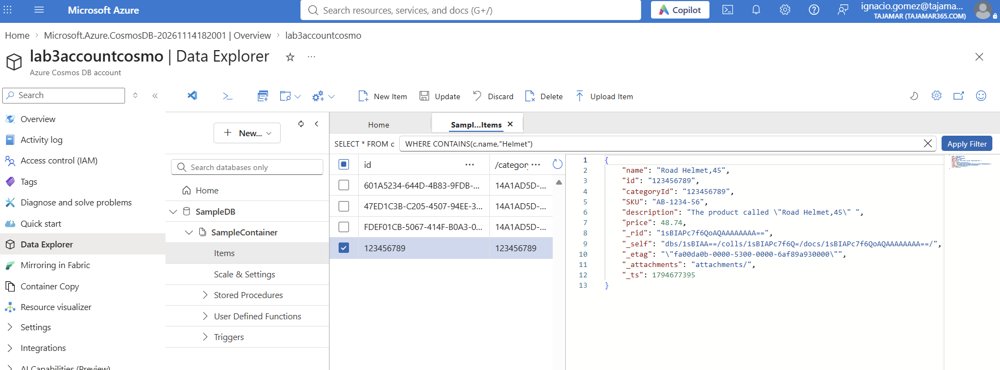

# Lab 3 · Azure Cosmos DB

## Entorno

| Parámetro | Valor |
|-----------|-------|
| Suscripción | Azure for Students |
| Grupo de recursos | `Lab3` |
| Cuenta de Cosmos DB | `lab3accountcosmo` |

## Pasos

### 1. Despliegue de la cuenta de Cosmos DB



### 2. Creación del contenedor de ejemplo

Desde Data Explorer, base de datos `SampleDB` y contenedor `SampleContainer` con partition key `/categoryId`.



### 3. Exploración de los items



### 4. Nuevo item y filtro

Creación del item `Road Helmet,45` y filtrado de los items cuyo nombre contiene "Helmet":

```sql
SELECT * FROM c WHERE CONTAINS(c.name, "Helmet")
```


