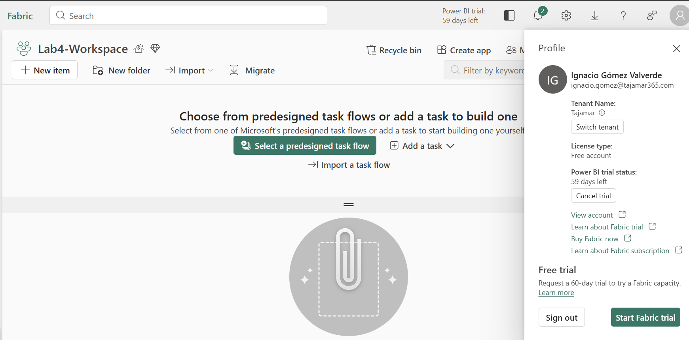
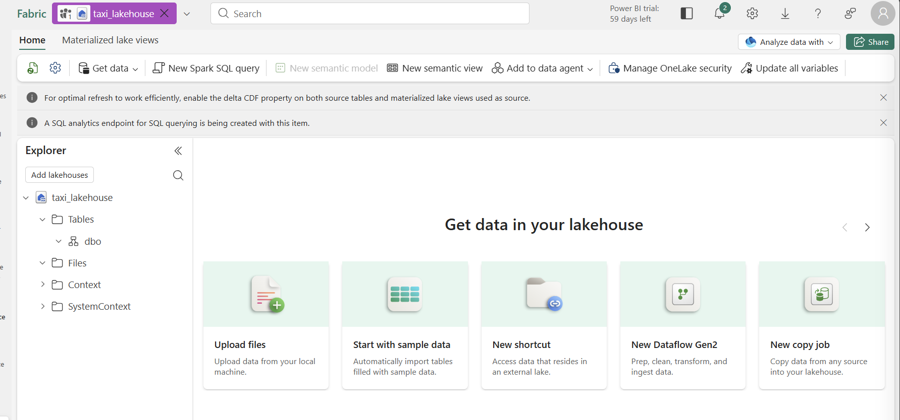
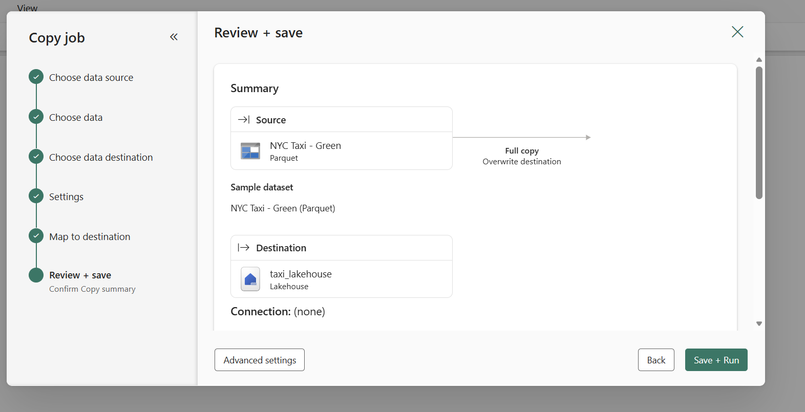
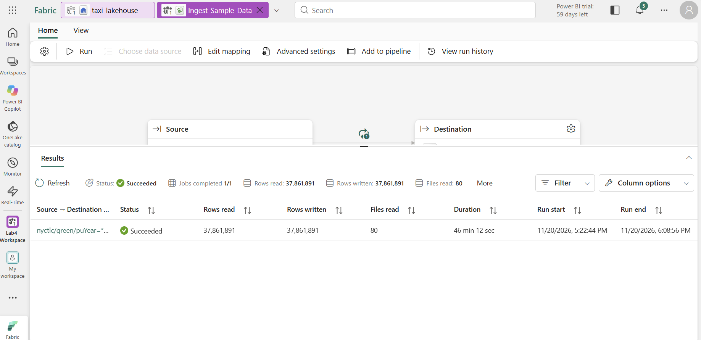
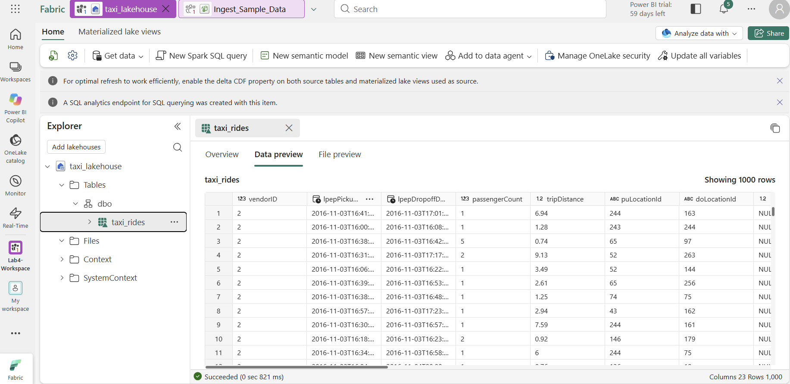
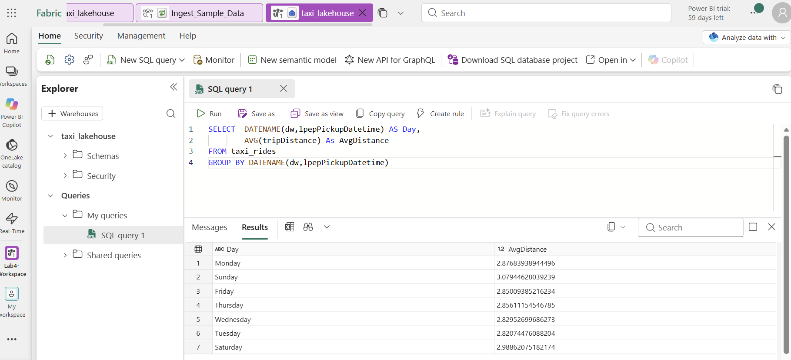
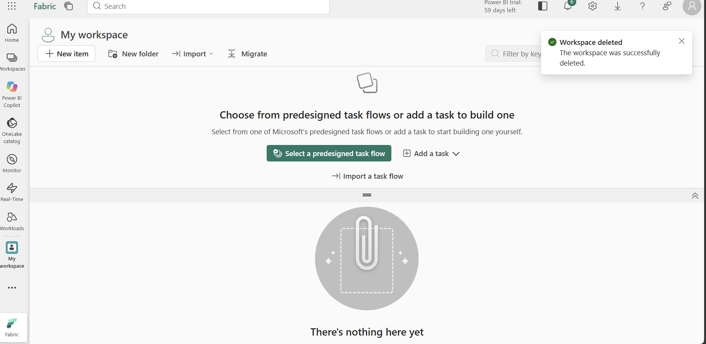

# Lab 4 · Microsoft Fabric

## Entorno

| Parámetro | Valor |
|-----------|-------|
| Plataforma | Microsoft Fabric (Tajamar) |
| Workspace | `Lab4-Workspace` |
| Lakehouse | `taxi_lakehouse` |
| Copy job | `Ingest_Sample_Data` |

## Pasos

### 1. Creación del workspace



### 2. Creación del lakehouse



### 3. Configuración del copy job

Origen: sample data NYC Taxi - Green (Parquet). Destino: tabla `dbo.taxi_rides` del lakehouse, con copia completa.



### 4. Ejecución del copy job

37 861 891 filas copiadas en 46 min.



### 5. Vista previa de la tabla taxi_rides



### 6. Consulta desde el SQL analytics endpoint

Distancia media de los trayectos por día de la semana:

```sql
SELECT DATENAME(dw, lpepPickupDatetime) AS Day,
       AVG(tripDistance) AS AvgDistance
FROM taxi_rides
GROUP BY DATENAME(dw, lpepPickupDatetime)
```



### 7. Eliminación del workspace


