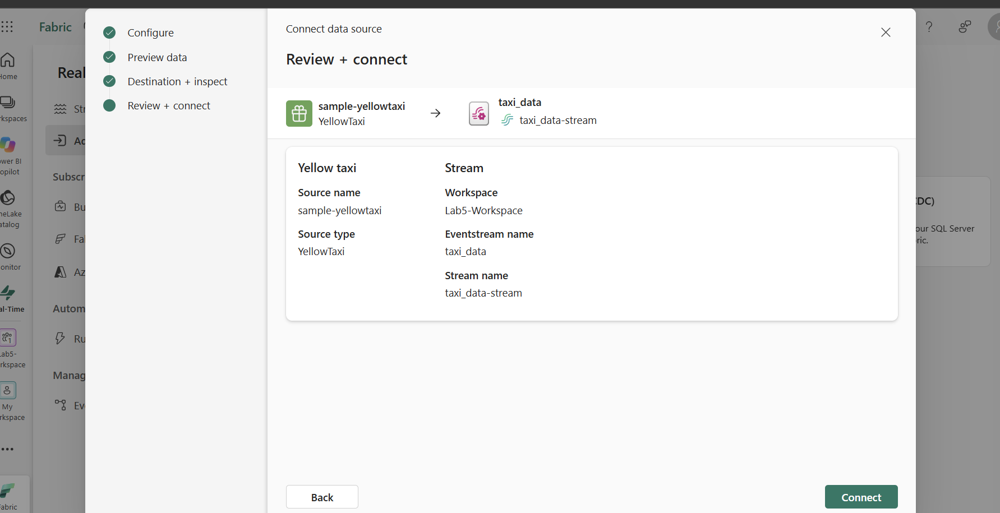
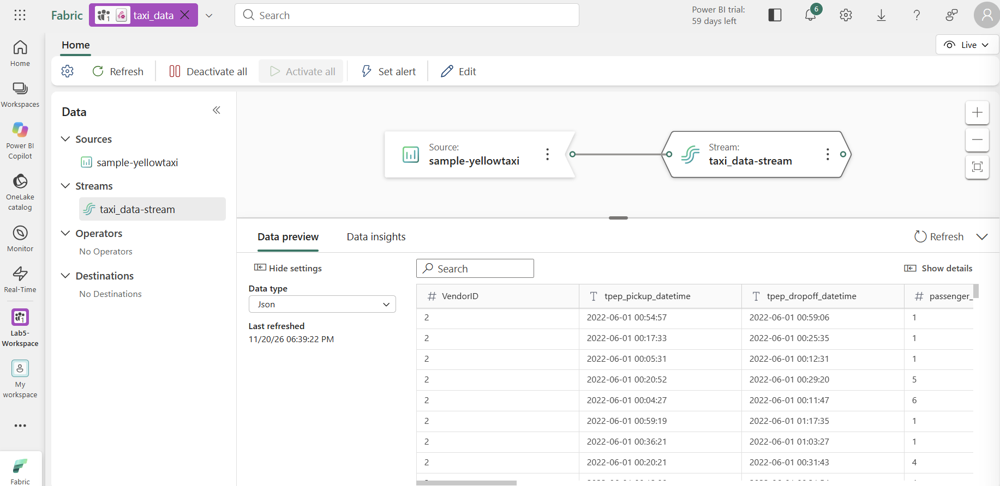
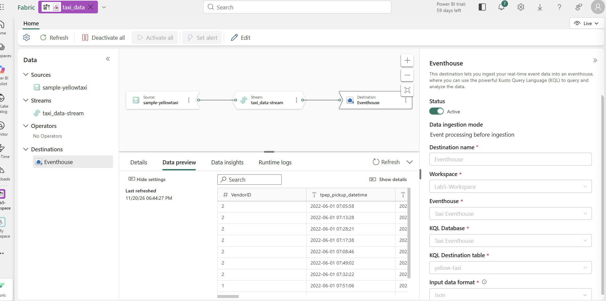
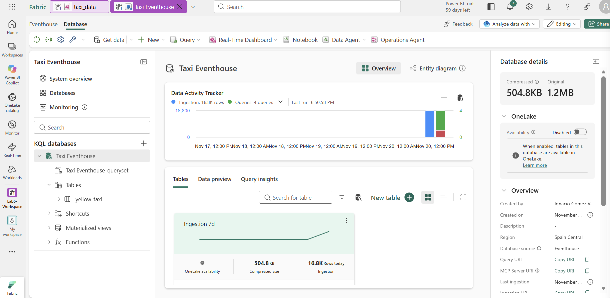
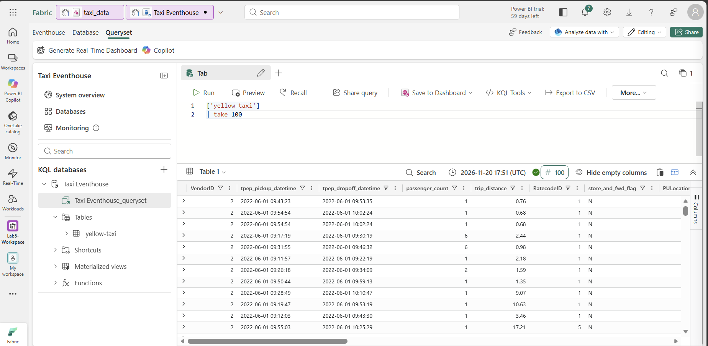
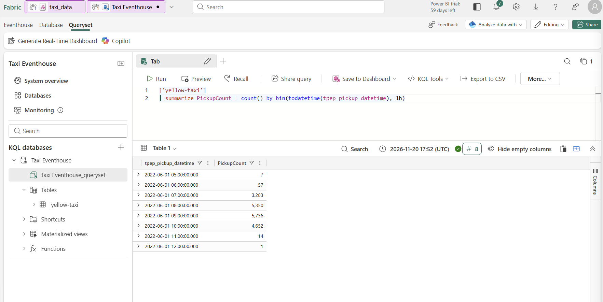
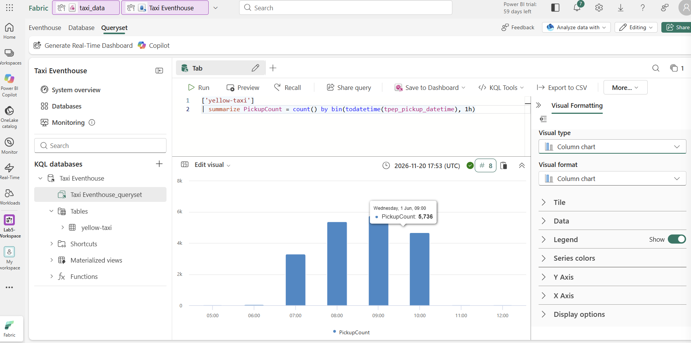
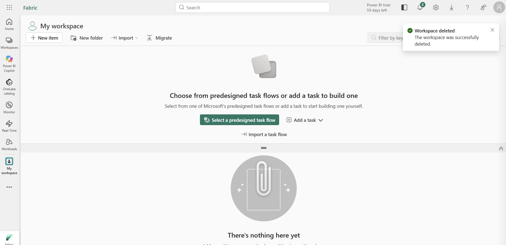

# Lab 5 · Real-time analytics en Microsoft Fabric

## Entorno

| Parámetro | Valor |
|-----------|-------|
| Plataforma | Microsoft Fabric (Tajamar) |
| Workspace | `Lab5-Workspace` |
| Eventstream | `taxi_data` |
| Origen | `sample-yellowtaxi` (Yellow taxi) |
| Eventhouse | `Taxi Eventhouse` |
| Tabla KQL | `yellow-taxi` |

## Pasos

### 1. Conexión del origen Yellow taxi al eventstream

Desde el Real-Time hub, origen de ejemplo Yellow taxi hacia el eventstream `taxi_data` del workspace `Lab5-Workspace`.



### 2. Eventstream en vivo



### 3. Eventhouse como destino del stream



### 4. Base de datos KQL con la tabla yellow-taxi



### 5. Consulta KQL: primeras 100 filas

```kql
['yellow-taxi']
| take 100
```



### 6. Consulta KQL: recogidas por hora

```kql
['yellow-taxi']
| summarize PickupCount = count() by bin(todatetime(tpep_pickup_datetime), 1h)
```



### 7. Gráfico de columnas de recogidas por hora



### 8. Eliminación del workspace


