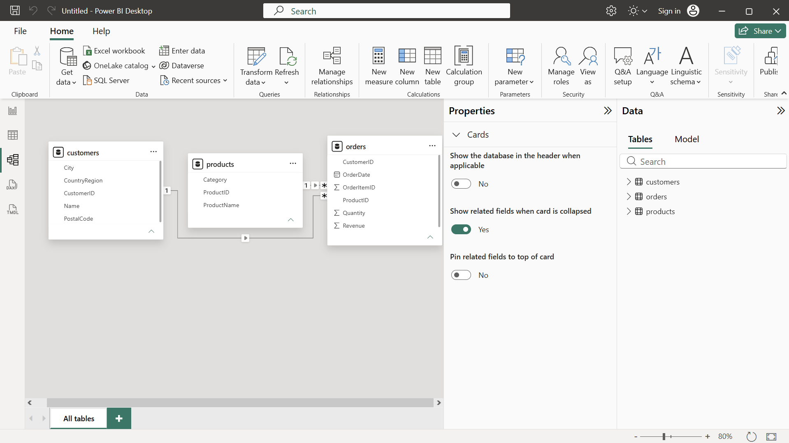
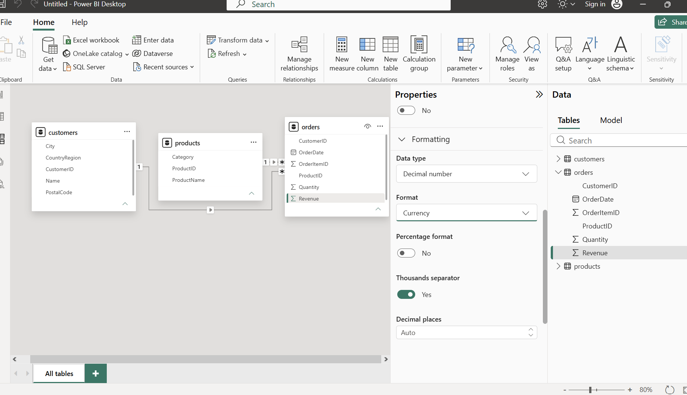
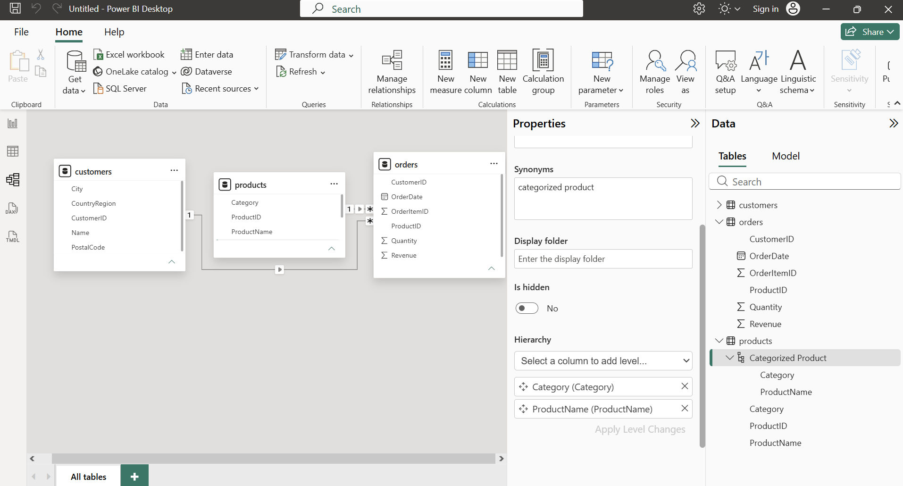
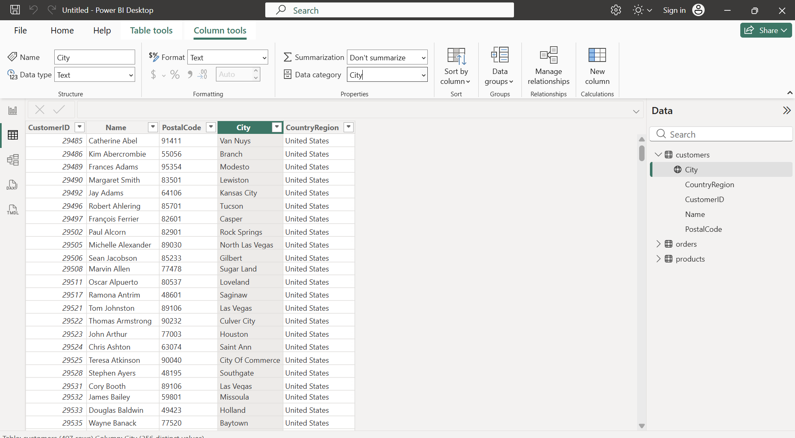
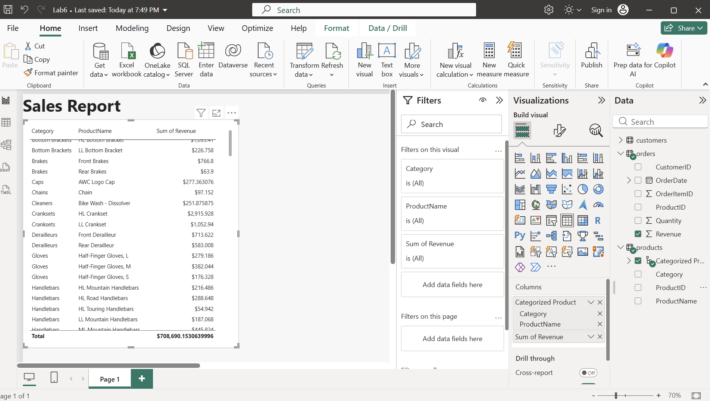
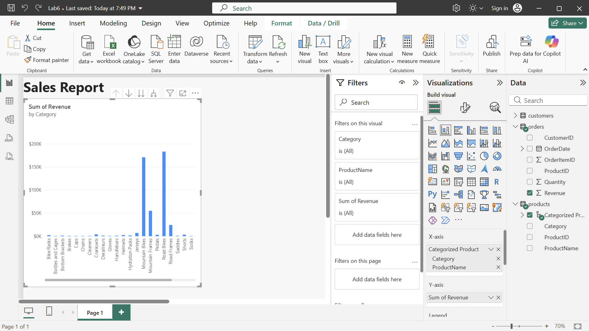
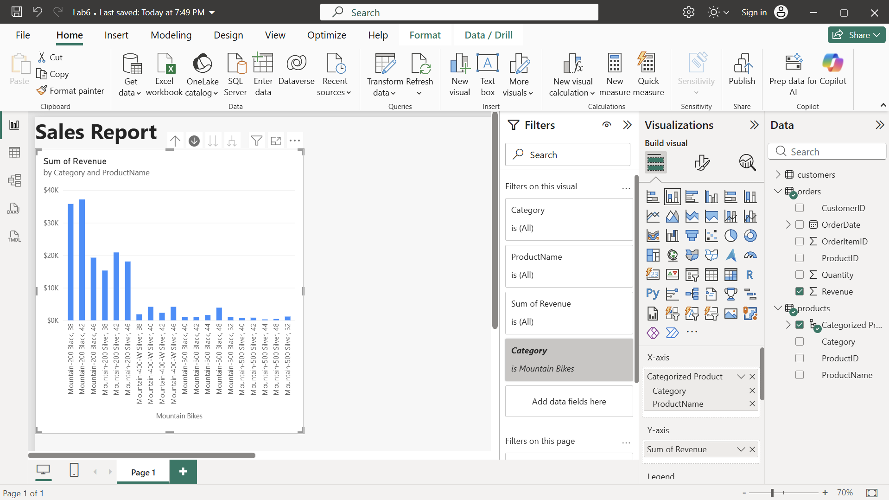
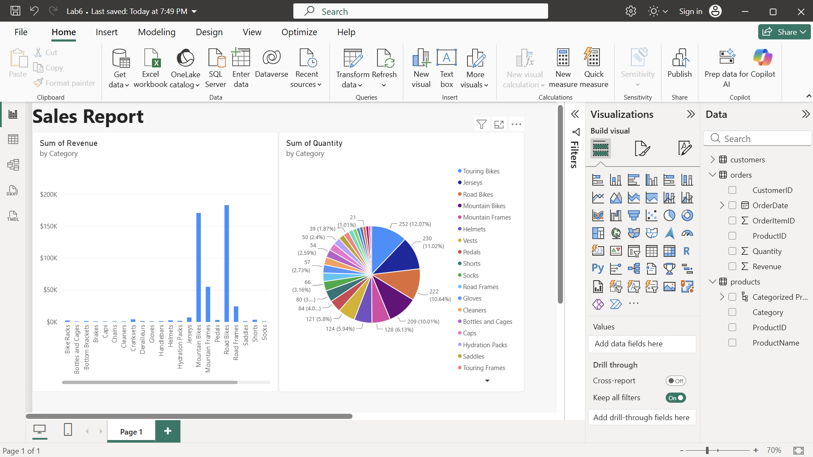
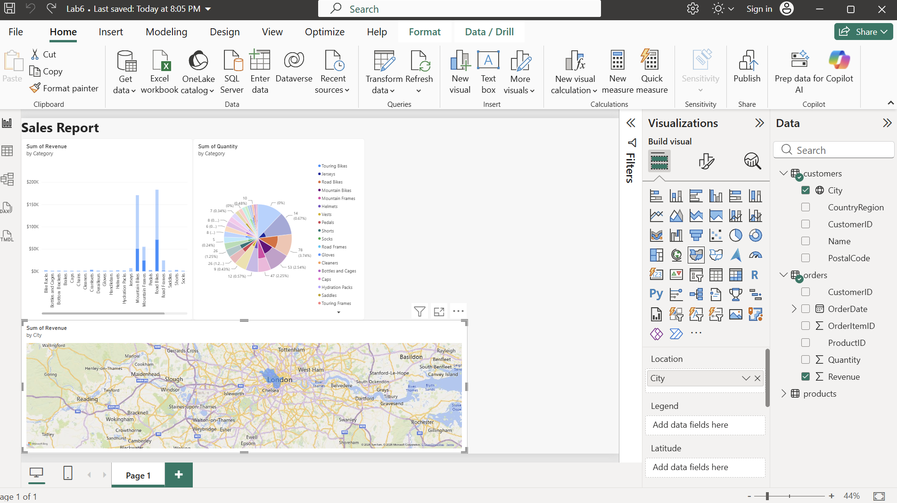

# Lab 6 · Power BI

## Entorno

| Parámetro | Valor |
|-----------|-------|
| Herramienta | Power BI Desktop |
| Datos | `customers.csv`, `products.csv`, `orders.csv` (origen Web) |
| Informe | [`Lab6.pbix`](./files/Lab6.pbix) |

## Pasos

### 1. Importación de datos y modelo

Las tres tablas se importan desde la web y Power BI detecta las relaciones `customers` → `orders` y `products` → `orders`.

### 2. Formato de moneda para Revenue

### 3. Jerarquía Categorized Product

Jerarquía en `products` con los niveles `Category` → `ProductName`.

### 4. Categoría de datos City

### 5. Tabla con Categorized Product y Revenue

### 6. Gráfico de columnas apiladas por categoría

### 7. Drill down a producto

Desglose de la categoría Mountain Bikes por producto usando la jerarquía.

### 8. Gráfico circular de cantidades por categoría

### 9. Mapa de ingresos por ciudad e interacción entre visuales

Al seleccionar una ciudad en el mapa, el resto de visuales del informe se filtran para resaltar sus datos.

